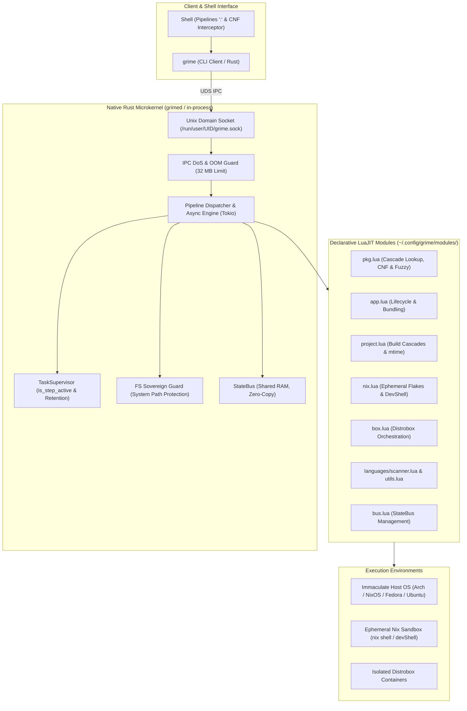

**[ 🇬🇧 English ](README.en.md) • [ 🇷🇺 Русский ](README.md)**

# GRIME (Next Generation / Grime-RS) 🦀🌙

[](https://github.com/ValetJk010/Grime_Project/releases/tag/v1.1.0)
[](https://www.rust-lang.org/)
[](https://luajit.org/)
[](https://nixos.org/)
[](https://distrobox.it/)
[]()
[-brightgreen.svg)]()
[](LICENSE)

> **The Ephemeral-First Manifest: The Host OS is sacred and immaculate. Just run it.**  
> High-performance system orchestrator for projects, containers, and ephemeral Nix environments bridging native Rust and declarative LuaJIT.

**GRIME** liberates developers from the age-old nightmare of dependency administration ("Dependency Hell"), host system degradation, and compiler fragmentation. You no longer need to turn your workstation into a dumping ground of temporary packages, conflicting libraries, and fragmented build tools.

GRIME fuses the mathematical reproducibility of **Nix Flakes**, the flexibility of **Distrobox** containers, and the raw speed of a **Rust** microkernel into a seamless developer experience: any utility, compiler, or service is accessible instantaneously in a single command — leaving zero trace on your host machine.

---

## ⚡ Section 1. Ephemeral Magic: "Just Run" (Zero-Friction Execution)

Traditional Linux administration is broken: to run a quick task, a developer is forced to execute `sudo pacman -S`, `apt install`, or `pip install --user`. Over time, the operating system inevitably decays into an irreproducible snowflake of conflicting `libssl` versions, disparate Python builds, drifting dynamic libraries, and orphaned files in `/usr/lib` and `/var`.

**In the GRIME universe, the host operating system remains sacred, immutable, and crystal-clean.**

```
               [ User Enters Command in Terminal ]
                                  │
                                  ▼
               ┌─────────────────────────────────────┐
               │    Intelligent Cascade Lookup       │
               └──────────────────┬──────────────────┘
                                  │
      ┌───────────────────────────┴───────────────────────────┐
      │                                                       │
  [ Found Locally? ]                                  [ Not Found Locally? ]
      │                                                       │
      ├─► Grime Apps (~/apps/*)                               │
      ├─► Host Binaries ($PATH)                               │
      ├─► Flatpak Applications                                ▼
      ├─► Nix Profile ($HOME/.nix-profile)        ┌─────────────────────────┐
      ├─► Local Toolchains (Cargo/Go)             │    Nixpkgs Catalog      │
      └─► Distrobox Containers (fedora-box)       │  (nix shell nixpkgs#…)  │
                                                  └───────────┬─────────────┘
                                                              │
                                                              ▼
                                                ┌───────────────────────────┐
                                                │     Ephemeral Sandbox     │
                                                │  (0 bytes junk on host)   │
                                                └───────────────────────────┘
```

### 1. Seamless Shell Command Interception (`command_not_found`)
Shell integration (Fish, Bash, Zsh) makes running any tool completely transparent. Simply type the name of the command you need:

```text
> cbonsai
[Grime] Command 'cbonsai' not found on host.
Available in Nixpkgs. Run inside isolated environment? [Y/n]: y
```
- Press **Enter** (or `Y`) — and the utility launches instantly in a hermetic, ephemeral Nix sandbox.
- **Zero Host Impact:** when you exit the application, the host system remains completely untouched. No `sudo`, no leftover dependencies.
- In the exact same natural way, you can run `cmatrix`, `ffmpeg`, `ripgrep`, `figlet`, `htop`, `graphviz`, `cava`, and **100,000+** other packages from Nixpkgs.

### 2. Multi-Tier Intelligent Cascade Lookup
Before reaching out to the network or Nixpkgs, GRIME scans local environment tiers within sub-milliseconds:
1. **Grime Apps**: user-declared micro-applications (`~/Archive/apps/`).
2. **Host**: standard `$PATH` directories.
3. **Flatpak**: GUI and desktop application environments.
4. **Nix Profile**: persistent user profile installations.
5. **Language Toolchains**: binaries in `~/.cargo/bin`, `~/go/bin`.
6. **Distrobox Guest Containers**: if a tool is installed inside a container (e.g. `fedora-box`), GRIME transparently forwards execution there.

If the utility is found in any local layer, it runs immediately without network overhead. If it is not found anywhere locally, the ephemeral Nixpkgs runner engages automatically.

### 3. Scripted Automation: The `--no-confirm` Flag
For CI/CD workflows, automation scripts, and background pipelines, GRIME supports non-interactive execution:
```bash
# Automatic non-interactive execution via package module:
grime pkg run --no-confirm ffmpeg -i input.mp4 output.webm
grime pkg run -y ripgrep "TODO" .
```

### 4. Uncompromised PTY/TUI Support (`Stdio::inherit`)
The Grime-RS v1.1.0 microkernel features direct standard stream descriptor inheritance at the system level. Complex interactive terminal tools and TUIs (`nvim`, `btop`, `cava`, `cmatrix`, `less`) run with:
- Full **24-bit TrueColor** reproduction;
- Complete mouse input and terminal resize (`SIGWINCH`) handling;
- Zero I/O latency and zero buffering artifacts.

### 5. Smart Resolution & Fuzzy Typo Protection
- **Smart Package Resolution**: If a command binary name differs from its Nixpkgs package attribute (e.g., `uname` belongs to `coreutils`, `xargs` belongs to `findutils`), GRIME's built-in mapping database transparently resolves the correct attribute.
- **Damerau-Levenshtein Typo Correction (`grime.fuzzy`)**: If you mistype a command, GRIME instantly provides intelligent suggestions:
  ```text
  > carg build
  [Grime] Command 'carg' not found.
  💡 Did you mean: cargo?
  ```

---

## 🛠️ Section 2. Ephemeral Auto-Toolchain: Zero Compilers on Host

Traditional development workflows require bloating workstations with gigabytes of compilers: multiple versions of GCC, Clang/LLVM, Rust toolchains, OpenJDK, Python development headers, CMake, Ninja, and Meson.

With GRIME, **developers no longer need compilers installed on the host**:

```
 [ Project Source Tree ] 
            │
            ▼
 ┌────────────────────────┐
 │   Scanner (scanner.lua)│ ──► Auto-detects C++, Rust, Python, Java, Go
 └───────────┬────────────┘
            │
            ▼
 ┌────────────────────────┐
 │  Ephemeral Nix Flake   │ ──► On-the-fly devShell synthesized in ~/.cache/grime/
 └───────────┬────────────┘
            │
            ▼
 ┌────────────────────────┐
 │   Hermetic Build Step  │ ──► Zero Dirty Tree (Working directory stays immaculate)
 └────────────────────────┘
```

1. **Intelligent Source Scanner (`languages/scanner.lua`)**:
   - Inspects project trees and build manifests (`CMakeLists.txt`, `Cargo.toml`, `Makefile`, `pom.xml`, `.cpp`, `.rs`, `.py`, `.java`, `.go`).
   - Constructs a minimal, complete build graph and populates `nativeBuildInputs`.
2. **Zero Dirty Tree Principle**:
   - Ephemeral Flake manifests are generated on the fly inside an isolated cache directory (`~/.cache/grime/flakes/<hash>/`).
   - Leaves **zero stray files** (`flake.nix`, `flake.lock`, `.direnv`) in your project's working directory.
3. **Declarative Custom Dependencies (`special_dependencies`)**:
   - Project-specific system libraries (`openssl`, `boost`, `raylib`, `opencv`) are declared cleanly in `app.lua` and seamlessly merged into the auto-toolchain:
   ```lua
   special_dependencies = { "openssl", "boost", "raylib" }
   ```
4. **Single-Command Build & Run**:
   ```bash
   grime project build   # Compiles inside ephemeral toolchain
   grime project run     # Executes with automatic mtime change detection
   ```

---

## 📦 Section 3. Seamless Harmony with Distrobox & Containers

GRIME removes boundaries between Linux distributions. You never need to manage disparate virtual machines or remain trapped inside an interactive container shell.

### 1. Transparent Cross-Environment Pipelines
Pipeline steps run across environments separated by colons `:`.
```bash
# Initialize C++ project -> Build in Fedora container -> Return to Host -> Run on Host
grime project cpp init MyService : box fedora-box : project build : host : project run
```
- The boundary module `host` cleanly and safely switches execution back to the host operating system.
- Environment variables, binary buffers, and file descriptors pass across container boundaries effortlessly.

### 2. Direct Invocation of Guest Package Managers
Need to use DNF or APT without leaving your host terminal?
```bash
# Transparent execution inside fedora-box without manual "distrobox enter":
grime box fedora-box run dnf search ripgrep
grime box fedora-box run dnf install -y neofetch
```
GRIME's cascade runner can also automatically route unrecognized commands to `fedora-box` when found inside the container.

### 3. Binary & Desktop Application Export
```bash
grime box export bin /usr/bin/some-tool   # Exports guest binary into host ~/.local/bin
grime box export app my-gui-app          # Exports desktop .desktop launcher
```

---

## 🔬 Section 4. Production-Grade Power of Grime-RS v1.1.0 Microkernel

Beneath the effortless developer experience lies a rigorous engineering architecture built for maximum resilience and extreme performance.

### 🦀 Native Rust Microkernel (Grime-RS)
- **Sub-Millisecond Responsiveness**: CLI cold start of **`~2.8 ms`**, IPC socket latency of **`1.1 ms`**.
- **Minimal Footprint**: Resident daemon `grimed` consumes only **4–6 MB RAM** at idle.
- **Memory Safety**: Zero race conditions, zero memory leaks, and complete type safety guaranteed by Rust.

### 🌙 Declarative LuaJIT FFI Modules
- All domain logic, compilation rules, and integrations are organized as dynamic modules (`~/.config/grime/modules/`).
- **Sandboxing & Hot-Reload**: Modules update instantly without restarting the background daemon.
- Direct invocation of native C APIs via high-performance FFI.

### 🚀 Microservice Lifecycle Orchestration (`grime app`)
- **Declarative `app.lua` Manifest**: Compact specification of build, run, dependencies, and environment variables.
- **Supervision & Daemonization**: Background execution (`--detach`), PID tracking, and graceful shutdown (`grime app stop`).
- **Polyglot Workflows**: Effortlessly bridge C++ high-performance compute engines with Python analysis scripts within one application.

### 📦 Self-Contained Standalone Executables (`grime app bundle`)
The `grime app bundle <app>` command creates a self-sufficient binary in `dist/`:
- Embeds all dynamic libraries, interpreters, and glibc directly into a portable binary.
- The resulting artifact runs on **any standard Linux distribution** without Nix, without compilers, and without external dependencies.

### 🔀 In-Memory StateBus (`grime bus`) & Task Supervision
- **RAM StateBus**: Thread-safe structured metadata exchange between pipeline stages without brittle stdout text parsing.
- **RAII Pipeline Cleanup**: Keys in the `pipeline.*` namespace are automatically erased upon pipeline completion.
- **TaskSupervisor**:
  - `is_step_active`: Prevents false watchdog timeouts during lengthy compilation stages.
  - Retention Policy (1 Hour): Automatic pruning of completed task records and file descriptors.
  - Mutex Poison Recovery: Resilient recovery of shared state after worker thread panics.
- **Filesystem Sovereignty**: Strict hard blocking of destructive operations against critical host directories (`/`, `/etc`, `/usr`, `/nix`, `/var`, `/boot`, `/root`).

### 🔍 Dual Audit (Git + Nix Closures) & Atomic Snapshots
- `grime app diff <app>`: Simultaneously inspects source code differences via `git diff` and closure structure divergences via `nix store diff-closures`.
- `grime app snapshot <app> "label"`: Creates atomic restore checkpoints.
- `grime app rollback <app>`: Instant rollback to a stable application state.
- `grime doctor`: Comprehensive system diagnostic suite for tools, sockets, and containers.

---

## 🏗️ System Architecture



---

## 📊 Performance Benchmarks

Measured latency metrics and runtime overhead:

| Metric | Value | Test Description & Conditions |
| :--- | :--- | :--- |
| **CLI Cold Start (`grime`)** | **`~2.8 ms`** | From binary launch to LuaJIT VM initialization and pipeline parsing |
| **IPC Socket Roundtrip** | **`1.1 ms`** | Full request-response cycle over Unix Domain Socket |
| **Idle Memory Consumption** | **`4–6 MB`** | Resident Set Size (RSS) of the background `grimed` microkernel |
| **Ephemeral Flake Synthesis** | **`< 15 ms`** | Source hashing, toolchain synthesis, and devShell caching |
| **IPC Payload Limit** | **`32 MB`** | Hardware and memory guard against OOM and socket attacks |

---

## 🚀 Quick Start

### 1. Build & Installation

#### Via Nix Flake (Recommended Hermetic Method):
```bash
# Build static binaries with zero external runtime dependencies:
nix build .#static

# Or enter ready development shell:
nix develop
```

#### Standard Cargo Build:
```bash
cargo build --release
```
Compiled binaries will be available at:
- `target/release/grime` — Ultra-fast CLI client;
- `target/release/grimed` — Resident background daemon.

Install into your user `PATH`:
```bash
cp target/release/grime target/release/grimed ~/.local/bin/
```

### 2. Launch Background Daemon (Optional)
```bash
# Start background resident daemon:
grimed --daemon

# Verify core health and module availability:
grime doctor
```
*(If the daemon is not running, `grime` executes commands locally in-process with identical features).*

### 3. Connect Command-Not-Found Interceptor in Fish Shell
Add the hook to `~/.config/fish/functions/fish_command_not_found.fish`:
```fish
function fish_command_not_found
    grime pkg not-found $argv
end
```
Now any unrecognized utility entered in your terminal is caught by GRIME and executed inside an ephemeral Nix sandbox or matching local environment.

---

## 💡 Real-World Scenarios

### 1. Ephemeral Tool Execution Without Host Installation
```bash
# One-off run of an interactive TUI utility:
grime pkg run cmatrix

# Automated execution with complex arguments and zero prompts:
grime pkg run --no-confirm ffmpeg -version
```

### 2. Build C++ Project via Auto-Toolchain in Ephemeral Sandbox
```bash
# Initialize, build, and run with zero compilers installed on the host:
grime project cpp init FastService
grime nix build FastService
grime project run FastService
```

### 3. Seamless Multi-Environment Cross-Container Pipeline
```bash
# Init Project -> Build inside Fedora container -> Switch to Host -> Run on Host
grime project rust MicroCli : box fedora-box : project build : host : project run
```

### 4. Create and Supervise a Microservice
```bash
# Create service from template
grime app new telemetry-agent --lang rust

# Launch in background with PID tracking and supervision
grime app run telemetry-agent --detach

# List running services
grime app list

# Stop service
grime app stop telemetry-agent
```

### 5. Package Application into Portable Standalone Binary
```bash
# Compile and bake all dependencies into dist/polyapp:
grime app bundle polyapp

# Portable binary can be deployed to any Linux machine:
./apps/polyapp/dist/polyapp
```

---

## 📝 Application Manifest Specification (`app.lua`)

Each isolated microservice or application is declared via `app.lua`:

```lua
return {
    -- Application identification
    name = "compute-worker",
    version = "1.0.0",
    description = "High-performance analytics worker",
    type = "polyglot", -- cpp, rust, python, java, polyglot, generic

    -- Build instructions & artifact
    build = "g++ -O3 src/engine.cpp -o engine",
    artifact = "engine",
    run = "./engine",
    sources = { "src/engine.cpp", "scripts/analyzer.py" },

    -- Auto-toolchain & specific Nixpkgs dependencies
    special_dependencies = {
        "openssl",
        "boost",
        "python3"
    },

    -- Daemonization settings
    detached = false,
    env = {
        LOG_LEVEL = "info",
        WORKER_THREADS = "4"
    }
}
```

---

## 🛠️ Extension Modules

The repository includes declarative LuaJIT modules (`modules/`), each addressing a dedicated domain:

- [`modules/pkg.lua`](modules/pkg.lua) — Multi-package manager, cascade lookup, fuzzy typo detection, and interactive Command-Not-Found.
- [`modules/app.lua`](modules/app.lua) — Full application lifecycle, daemonization, Git snapshots, Nix closure audit, and bundling.
- [`modules/project.lua`](modules/project.lua) — Developer project orchestration, fuzzy directory lookup, and mtime validation.
- [`modules/languages/`](modules/languages/) — Compiler and build adapters for C++, Rust, Python, Java with smart scanner [`scanner.lua`](modules/languages/scanner.lua) and shared tools [`utils.lua`](modules/languages/utils.lua).
- [`modules/nix.lua`](modules/nix.lua) — Declarative and ephemeral Nix Flake/DevShell environments, garbage collection (`gc`), deduplication (`optimise`), generation history, and rollback.
- [`modules/box.lua`](modules/box.lua) — Orchestration and execution inside isolated Distrobox containers, binary and desktop application export.
- [`modules/daemon.lua`](modules/daemon.lua) — Management of the `grimed` service: status, memory monitoring, socket verification, restart, and diagnostic logs.
- [`modules/aider.lua`](modules/aider.lua) — Integration of the autonomous AI coding agent Aider directly into the Grime pipeline.
- [`modules/bus.lua`](modules/bus.lua) — StateBus shared memory across pipeline steps.
- [`modules/git.lua`](modules/git.lua) — High-level Git operations, changes audit, and snapshots.
- [`modules/doctor.lua`](modules/doctor.lua) — Deep diagnostic suite for host tools, sockets, and containers.
- [`modules/log.lua`](modules/log.lua) — Structured system logging.
- [`modules/host.lua`](modules/host.lua) — Boundary module for returning pipeline execution context to the host OS.
- [`modules/cmd.lua`](modules/cmd.lua) — Fallback module for executing one-off system commands.

---

## 📄 License

This project is licensed under the open-source **[MIT License](LICENSE)**.

You are completely free to use, modify, distribute, and integrate GRIME into personal, academic, research, and commercial projects without royalties or hidden restrictions.

Copyright (c) 2026 **ValetJk010 / Danny**.
