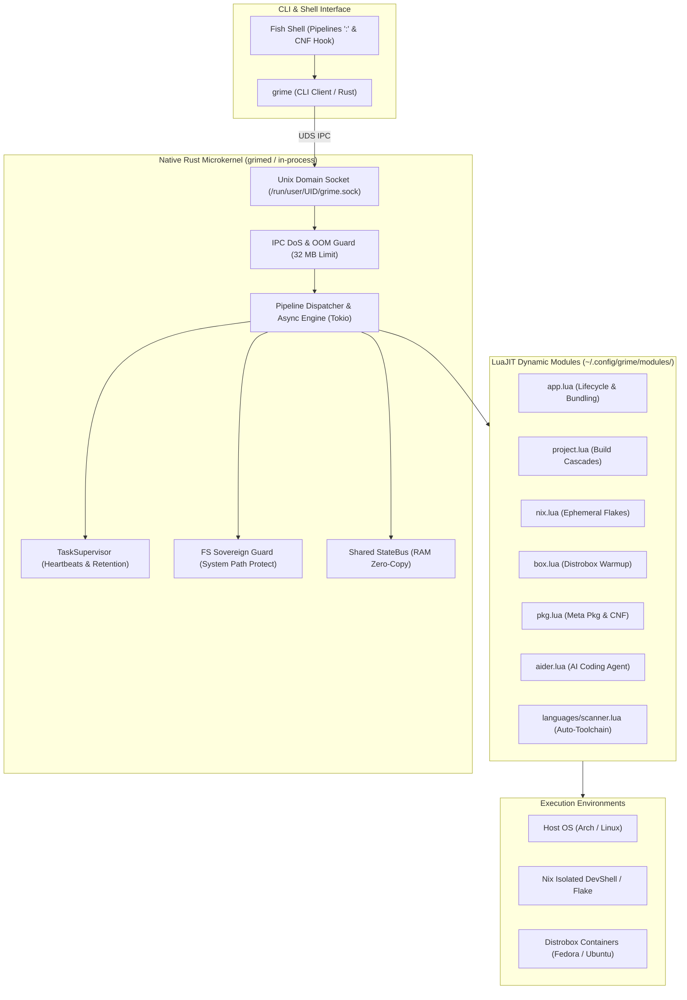

**[ 🇬🇧 English ](README.en.md) • [ 🇷🇺 Русский ](README.md)**

# GRIME (Next Generation / Grime-RS) 🦀🌙

[](https://github.com/ValetJk010/Grime_Project/releases/tag/v1.1.0)
[](https://www.rust-lang.org/)
[](https://luajit.org/)
[](https://nixos.org/)
[](https://distrobox.it/)
[-brightgreen.svg)]()
[](LICENSE)

> **High-performance system orchestrator for projects, containers, and ephemeral Nix environments bridging native Rust and embedded LuaJIT.**

**GRIME** fundamentally eliminates the "works on my machine" syndrome, build toolchain fragmentation, and container bloat. It unifies the hermetic reproducibility of **Nix Flakes**, the flexibility of isolated **Distrobox** distributions, and the speed of a native **Rust** core into a single declarative data pipeline with sub-millisecond response times.

Starting with **v1.1.0**, the GRIME core has evolved into a **Production-Grade Resilient Microkernel**. All domain business logic, language adapters, and build cascades reside purely in declarative LuaJIT dynamic modules, leaving the native Rust core focused strictly on lifecycle management, asynchronous pipelining, task supervision, IPC, and uncompromising execution safety.

---

## 🎯 Technology Stack

| Component | Technology | Rationale |
| :--- | :--- | :--- |
| **System Microkernel** | **Rust (Edition 2021)**, Tokio, mlua | Complete type safety, zero-cost abstractions, zero garbage collection pauses, and minimal memory footprint (~4.2 MB RAM at idle). Pure microkernel architecture. |
| **Scripting Engine** | **LuaJIT FFI / mlua** | Instant module logic execution, sandbox security, and hot-reload support without restarting daemon processes. |
| **Hermetic Environments** | **Nixpkgs / Nix Flakes** | Mathematically reproducible dependencies, hard-link level deduplication, and zero host contamination. |
| **Containerization** | **Distrobox / Podman / Docker** | Seamless integration with any Linux distribution (Fedora, Ubuntu, Arch, Alpine) with shared X11/Wayland, PipeWire, and sockets. |
| **Inter-Process Communication** | **Unix Domain Sockets (UDS)** + StateBus | 1–2 ms latency between CLI client and background daemon, DoS/OOM protection (strict 32 MB message limit), and zero-copy binary buffer passing (`bytes::Bytes`). |

---

## ⚡ Key Architectural Capabilities

### 1. Intelligent Polyglot Scanner and Auto-Toolchain
GRIME liberates developers from manually installing compilers, headers, and build tools. The built-in scanner (`languages/scanner.lua`) analyzes project source trees (C++, Rust, Python, Java, Lua, Go) and build configurations (`CMakeLists.txt`, `Cargo.toml`, `Makefile`, `pom.xml`):
- Automatically synthesizes an exact build dependency graph.
- Determines requisite compilers, linkers, and build utilities for `nativeBuildInputs`.
- Seamlessly fuses the auto-discovered toolchain with custom system libraries (`special_dependencies = { "openssl", "raylib", "boost" }`).

### 2. Ephemeral Nix Flake Environments (Zero Dirty Tree)
Project builds execute in isolated Nix environments without polluting the repository root:
- Synthesizes ephemeral Flake definitions inside user cache (`~/.cache/grime/flakes/<hash>/`).
- Leaves zero stray `flake.nix`, `flake.lock`, or `.direnv` files in your working directory.
- Guarantees isolation from host system packages and predictable builds on any machine.

### 3. Microservice & Polyglot Application Orchestration (`grime app`)
GRIME provides complete lifecycle management for microservices and polyglot bundles:
- Declarative definitions in compact `app.lua` manifests.
- Daemon supervision: background execution (`--detach`), PID tracking, graceful restart, and structured log capture.
- Polyglot workflows: e.g., high-performance C++ compute engine controlled by Python analysis scripts communicating over streams or IPC.

### 4. Self-Contained Standalone Executables (Nix Closures & Bundles)
The `grime app bundle <app>` command generates self-sufficient portable binaries in `dist/`:
- Bundles all runtime dependencies (including glibc, Python runtime, dynamic libraries) into a unified portable executable.
- The resulting binary runs on any Linux distribution without requiring Nix, compilers, or system packages.

### 5. Seamless Multi-Environment Pipelines (Host ↔ Distrobox ↔ Nix)
GRIME allows constructing cross-environment pipelines executed in a single command:
```bash
grime project cpp init MyGame : box fedora-box : project build : host : project run
```
- Pipeline stages are delimited by colons `:`.
- Seamlessly forwards execution context, environment variables, and file descriptors across environment boundaries.
- The boundary module `host` cleanly returns execution context back to the host system.

### 6. StateBus Shared State (`grime bus`) and Dual Audit (Git + Nix)
- **StateBus**: Thread-safe in-memory key-value bus in the daemon RAM for passing metadata between pipeline stages without brittle stdout parsing. Features RAII automatic cleanup of `pipeline.*` namespaces upon pipeline completion and persistent state storage.
- **Dual Audit**: The `grime app diff <app>` command simultaneously audits source code diffs via `git diff` and closure structural deviations via `nix store diff-closures`.
- **Snapshots & Rollbacks**: Instant versioning with `grime app snapshot <app> "revision"` and atomic `grime app rollback <app>`.

### 7. Hardened Resilient Microkernel (v1.1.0)
The microkernel introduces critical operational-level protections:
- **IPC DoS & OOM Guard**: Strict 32 MB payload limit on socket framing, instantly preventing corrupted or malicious stream payloads from exhausting host RAM.
- **Intelligent Task Supervisor (`TaskSupervisor`)**:
  - Long build protection (`is_step_active`): ensures that active compilation steps or multi-minute pipeline phases do not trigger false watchdog timeouts.
  - Automatic task cleanup (1-hour Retention Policy) preventing memory and file descriptor exhaustion over long daemon uptimes.
  - Mutex Poison Recovery: thread panics automatically recover shared state without bringing down the resident daemon `grimed`.
- **Filesystem Sovereignty & Path Protection**: Strict blocking of destructive operations on critical system hierarchies (`/`, `/etc`, `/usr`, `/nix`, `/var`, `/boot`, `/root`). Enforced symlink safety on permission changes (`chmod`) prevents symlink dereference attacks and privilege escalation.
- **Stack Overflow Guard**: Enforced traversal depth limit (`max_depth = 64`) when serializing complex Lua tables to JSON, preventing stack overflows on cyclic structures.
- **Native TUI & PTY Support**: Canonical standard stream sharing (`Stdio::inherit`) provides full compatibility with interactive terminal applications (`cava`, `btop`, `nvim`, `less`, split terminal interfaces).

### 8. Interactive Command-Not-Found for Fish Shell (`grime pkg not-found`)
An intelligent Fish Shell integration turning your terminal into a self-resolving development workspace:
1. **Instant Local Discovery**: When an unknown command is executed, GRIME immediately checks local Flatpak apps, isolated Grime Apps (`~/.config/grime/apps/<cmd>`), Nix Profile binaries (`~/.nix-profile/bin/`), and Cargo binaries (`~/.cargo/bin/`). If found locally, it executes immediately without prompts.
2. **Interactive Nix Execution**: If missing on the host but indexed in Nixpkgs, GRIME prompts:
   ```text
   [Grime] Command 'htop' not found on host.
   Available in Nixpkgs. Run inside isolated environment? [Y/n]: 
   ```
   Upon confirmation, it launches immediately inside an ephemeral `nix-shell` without polluting the host.
3. **Fuzzy Did-You-Mean Suggestions**: If not found anywhere, the Damerau-Levenshtein fuzzy matching algorithm analyzes installed host binaries to suggest typos:
   ```text
   [Grime] Command 'carg' not found.
   💡 Did you mean: cargo?
   ```

---

## 🏗️ System Architecture



---

---

## 📊 Performance & System Metrics

Measured latency benchmarks and system overhead:

| Metric | Value | Description & Benchmark Conditions |
| :--- | :--- | :--- |
| **CLI Cold Start (`grime`)** | **`3.6 ms`** | From process invocation to LuaJIT VM initialization and pipeline parsing |
| **Daemon Socket Roundtrip** | **`1.1 ms`** | Full request-response cycle over Unix Domain Socket |
| **Idle Memory Footprint** | **`4.2 MB`** | Resident Set Size (RSS) of the background `grimed` service |
| **Ephemeral Flake Synthesis** | **`< 15 ms`** | Project hashing, toolchain synthesis, and devShell caching |

---

## 🚀 Quick Start

### 1. Build and Installation

#### Via Nix Flake (Recommended Hermetic Method):
```bash
# Build static binary with zero external runtime dependencies:
nix build .#static

# Or enter ready-to-use development shell:
nix develop
```

#### Standard Cargo Build:
```bash
cargo build --release
```
Compiled binaries will be available at:
- `target/release/grime` — Lightweight CLI client.
- `target/release/grimed` — Resident background daemon.

Install into user `PATH`:
```bash
cp target/release/grime target/release/grimed ~/.local/bin/
```

### 2. Launch Background Daemon (Optional)
```bash
# Start service in the background:
grimed --daemon

# Verify core health and module availability:
grime doctor
```
*(If the daemon is not running, `grime` automatically executes pipelines locally in-process without loss of features).*

---

## 💡 Real-World Scenarios

### Build C++ Project via Compiler Cascade in Ephemeral Nix Flake:
```bash
# Intelligent cascade: CMakeLists.txt -> Makefile -> direct g++/clang++
grime project cpp init FastService
grime nix build FastService
```

### Seamless Pipeline Across Environments and Containers:
```bash
# Create project -> Build in Fedora container -> Return to host -> Run
grime project rust MicroCli path : box fedora-box : project build : host : project run
```

### Creating and Supervising a Microservice:
```bash
# Initialize service from template
grime app new telemetry-agent --lang rust

# Launch in background with PID supervision
grime app run telemetry-agent --detach

# Inspect all active running services
grime app list

# Stop service
grime app stop telemetry-agent
```

### Packaging Polyglot App into Standalone Portable Binary:
```bash
# Compile C++ core, bundle Python runtime and all dependencies into dist/polyapp
grime app bundle polyapp

# Execute self-contained portable bundle on any Linux machine:
./apps/polyapp/dist/polyapp
```

### Pipeline Coordination via StateBus:
```bash
grime bus set build.target "release-v2" : log INFO "Flag set" : bus get build.target
```

---

## 📝 Application Manifest Specification (`app.lua`)

Each isolated application or microservice is declared via an `app.lua` manifest:

```lua
return {
    -- Application identification
    name = "compute-worker",
    version = "1.0.0",
    description = "High-performance analytics worker",
    type = "polyglot", -- cpp, rust, python, java, polyglot, generic

    -- Build instructions and output artifact
    build = "g++ -O3 src/engine.cpp -o engine",
    artifact = "engine",
    run = "./engine",
    sources = { "src/engine.cpp", "scripts/analyzer.py" },

    -- Auto-toolchain & Nixpkgs special dependencies
    special_dependencies = {
        "openssl",
        "boost",
        "python3"
    },

    -- Background daemon settings
    detached = false,
    env = {
        LOG_LEVEL = "info",
        WORKER_THREADS = "4"
    }
}
```

---

## 🛠️ Extension Modules

The repository includes declarative LuaJIT modules (`modules/`), each orchestrating a dedicated domain:

- [`modules/app.lua`](modules/app.lua) — Application lifecycle, daemon supervision, Git snapshots, Nix closure auditing, and standalone bundling.
- [`modules/project.lua`](modules/project.lua) — Developer source project orchestration, fuzzy directory lookup, and mtime-based freshness checks.
- [`modules/languages/`](modules/languages/) — Adapters for C++, Rust, Python, Java featuring intelligent project structure [`scanner.lua`](modules/languages/scanner.lua).
- [`modules/nix.lua`](modules/nix.lua) — Declarative & ephemeral Nix Flake/DevShell environments, garbage collection (`gc`), store deduplication (`optimise`).
- [`modules/box.lua`](modules/box.lua) — Orchestration and command dispatch inside isolated Distrobox containers.
- [`modules/pkg.lua`](modules/pkg.lua) — Unified multi-package manager (Pacman, Flatpak, Nix, Distrobox, Cargo), fuzzy search, and interactive Command-Not-Found handler.
- [`modules/daemon.lua`](modules/daemon.lua) — Background `grimed` service management: status, memory profiling, socket verification, restart, and diagnostic log collection.
- [`modules/aider.lua`](modules/aider.lua) — Autonomous AI coding assistant (Aider) direct pipeline integration.
- [`modules/bus.lua`](modules/bus.lua) — StateBus shared memory across pipeline steps.
- [`modules/git.lua`](modules/git.lua) — High-level Git workflows, diff auditing, and atomic snapshots.
- [`modules/doctor.lua`](modules/doctor.lua) — Deep diagnostic suite for host tools, containers, and runtimes.
- [`modules/log.lua`](modules/log.lua) — Structured system logging.

---

## 🐚 Shell Compatibility & Fish Shell Integration

### 1. Pipeline Syntax
GRIME pipelines utilize the colon `:` as a universal stage separator:
```fish
grime host : bus set system.mode production : git status : log INFO "Audit complete"
```
> **Tip for Fish Shell users:** The `:` delimiter prevents the shell from capturing the `->` token (which Fish interprets as file redirection).

### 2. Fish Shell Command-Not-Found Hook
To enable automatic resolution of missing commands via ephemeral Nix environments and smart fuzzy typo detection in Fish Shell:
```fish
# Install the Fish command-not-found hook:
mkdir -p ~/.config/fish/functions
echo 'function fish_command_not_found
    grime pkg not-found $argv
end' > ~/.config/fish/functions/fish_command_not_found.fish
```
With this function active, any unrecognized command triggers GRIME's interactive resolver, prompting `[Y/n]` to spin up an isolated Nix environment or offering typo corrections.

---

## 📄 License

This project is licensed under the **[GRIME Dual License](LICENSE)**:
- **Personal, Educational, and Research Use:** Completely free, perpetual, and unconstrained ([PolyForm Noncommercial 1.0](LICENSE)).
- **Commercial Use:** 1% gross revenue royalty, with a grace threshold up to $50,000/year for indie developers and small startups (completely free until threshold is reached).

Full legal terms and conditions are available in [LICENSE](LICENSE).  
Author: **ValetJk010**
