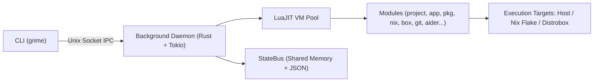

**[ Русский ](README.md) | [ English ](README.en.md)**

# GRIME (Grime-RS)

[](https://github.com/GrimeVoid/grime-rust/releases/tag/v1.1.0)
[](https://www.rust-lang.org/)
[](https://luajit.org/)
[](https://nixos.org/)
[](https://distrobox.it/)
[]()
[](LICENSE)

**GRIME** is a fast command-line orchestrator for Linux developers. It connects project management, isolated Nix Flake environments, Distrobox containers, system package managers, and the Aider AI assistant into a single, predictable CLI workflow.

The main goal of GRIME is to keep your host system clean. Instead of installing dozens of compilers, libraries, and one-off tools directly onto your base OS, you build and run software inside reproducible environments with a single short command.

---

## Why GRIME Exists

When working across multiple languages (C++, Rust, Python, Java, Lua), a Linux workstation quickly accumulates conflicting dependencies, multiple compiler versions, and forgotten packages. Tools like Nix, Podman/Distrobox, and custom build scripts solve parts of this problem, but each has its own syntax and friction.

GRIME removes that friction:
- **A clean host OS.** If you need a tool or compiler once, GRIME runs it transparently via Nixpkgs or inside a Distrobox container without leaving clutter on your host.
- **Automatic toolchain synthesis.** Point GRIME at a project directory and run a build — the scanner detects the languages used, generates an ephemeral Nix Flake in the user cache (`~/.cache/grime/`), and builds the project without polluting your repository with boilerplate files.
- **One consistent command standard.** You do not need to memorize separate CLI conventions for `cmake`, `cargo`, `javac`, `nix`, or `distrobox`. Projects, microservices, packages, and Git operations all follow the same rules.
- **True data pipelines.** Chain multiple modules in a single command: resolve a project path, enter a Fedora container, compile the binary, return to the host, and run it.

---

## Philosophy and How It Works

GRIME is split into two distinct layers: a **native Rust microkernel** and **declarative LuaJIT modules**.



1. **Native Rust Microkernel (`grime`)**
   The kernel intentionally contains no hardcoded tool-specific logic. Its job is to parse CLI arguments at sub-millisecond speed, dispatch execution to modules, manage multi-step pipelines, provide thread-safe state sharing via `StateBus`, and handle errors in one place. When any step fails, the kernel prints the error message exactly once and cleanly aborts the rest of the pipeline.
2. **Background Daemon and LuaJIT VM Pool**
   The resident daemon keeps a warm pool of LuaJIT virtual machines and the shared state bus in memory (using only 4–6 MB of RAM). When you run `grime`, the lightweight client communicates with the daemon over a Unix domain socket in about a millisecond. If the daemon is not running, commands execute seamlessly in-process.
3. **Declarative Modules (`modules/*.lua`)**
   All domain logic—compilers, package managers, Git, containers, and AI workflows—lives in LuaJIT modules. Modules can be edited on the fly without recompiling the Rust kernel, share a unified argument parser (`languages/argparse.lua`), and use the safe native kernel API (`grime.ctx`, `grime.fs`, `grime.process`, `grime.bus`, `grime.fuzzy`).

---

## Unified Command, Flag, and Pipeline Standard

Every module in GRIME follows the same syntax rules:

- **All flags and actions start with a dash (`-` or `--`).**
  For example: `-list` (`-ls`), `-path` (`-p`), `-new` (`-n`), `-build` (`-b`), `-run` (`-r`), `-rm`, `-update` (`-u`), `-help` (`-h`). Short and long forms are interchangeable.
- **Flexible target and flag order.**
  Both `grime project -path grime_pj` and `grime project grime_pj -path` work identically and support fuzzy matching on project and app names.
- **Argument separator `//` (or `--`).**
  To pass flags directly to an external binary without GRIME intercepting them, place `//` before the external arguments:
  ```bash
  grime cmd // echo -n "check"
  grime pkg -run // ffmpeg -i input.mp4 output.webm
  ```
- **Module pipelines with `:`.**
  Steps in a pipeline are separated by a colon `:` (safe in Fish shell, unlike `->` which acts as file redirection). Each step automatically forwards its working directory (`target_dir`), return value (`pipeline_input`), and `StateBus` entries to the next step:
  ```bash
  grime project -path MyService : git -status : bus -set build.ready true
  ```
- **Environment switching (`box` / `nix` and returning via `host`).**
  The `host` module acts as a boundary that returns pipeline execution from a Distrobox container or Nix shell back to the host OS:
  ```bash
  grime project -path MyEngine : box fedora-box : project -build : host : project -run
  ```

---

## Core Modules and Practical Examples

### 1. Polyglot Project Orchestrator (`project`)
Manages C++, Rust, Python, Java, and Lua projects. Supports fuzzy directory lookup, automatic build system detection, and source modification time (`mtime`) checks before running.

```bash
# Initialize a new project for a specific language
grime project -init rust fast_proxy
grime project -init cpp render_core

# Resolve project path (useful for quick navigation in Fish/Bash)
cd (grime project -path grime_pj)

# Build and run a project (rebuilds automatically only when sources change)
grime project -build grime_pj
grime project -run grime_pj

# List all projects across language directories
grime project -list
```

### 2. Local Micro-Applications (`app`)
Create, build, and supervise standalone local tools and services, each isolated in its own directory with an `app.lua` manifest and a dedicated `flake.nix`.

When creating an application (`-new`), you can describe what you want in plain language: GRIME automatically extracts the target stack (`python`, `java`, `rust`, `lua`, `cpp`) from your prompt, scaffolds the template, and invokes Aider to implement the code.

```bash
# Create an app with automatic language detection from the prompt
grime app -new WeatherCli "console app in Python that prints weather info"
grime app -new LogParser "log filtering tool in Rust"
grime app -new StoreApi "order management service in Java"

# Get the path to a specific app or the apps root directory
grime app -path WeatherCli
cd (grime app -path)

# Build and run an application (foreground or detached daemon mode)
grime app -build WeatherCli
grime app -run WeatherCli
grime app -run LogParser -detach

# Inspect running background apps and stop them
grime app -ps
grime app -stop LogParser

# Bundle an app with all its Nix dependencies into a portable binary in dist/
grime app -bundle WeatherCli

# Create Git snapshots, run dual audits (Git diff + Nix closure), or roll back
grime app -snapshot WeatherCli "working build"
grime app -diff WeatherCli
grime app -rollback WeatherCli
```

### 3. Unified Package and Tool Manager (`pkg`)
Provides a single interface across host package managers (`pacman`, `yay`, `dnf`, `apt`), `flatpak`, `nix` profile, `cargo`, `pipx`, and `distrobox` containers.

```bash
# Show an overview of all active package managers on the system
grime pkg

# List user-installed packages for a specific manager
grime pkg -pacman
grime pkg -yay
grime pkg -flatpak
grime pkg -nix

# Fuzzy-search for an installed package across all active managers
grime pkg ripgrep

# Install and remove packages
grime pkg -yay -install neovim
grime pkg -nix -install jq
grime pkg -flatpak -remove org.gimp.GIMP

# Update a specific manager or run a full system update (yay/pacman + flatpak + nix + distrobox)
grime pkg -update -yay
grime pkg -update

# Run any command ephemerally without installing it on the host
grime pkg -run cmatrix
grime pkg -run -y // ffmpeg -version
```

### 4. AI Pair-Programming Assistant (`aider`)
Integrates the Aider AI coding agent directly into GRIME workflows. It understands your project and app layouts, accepts pipeline output from previous steps, inspects recent terminal errors, and scaffolds or updates GRIME Lua modules following the project's architecture standard.

```bash
# Launch Aider in a project directory by name
grime aider grime_pj "optimize argument parsing"

# Pipe context from previous pipeline steps into Aider
grime project -path grime_pj : git -diff : aider -m "review changes and suggest a commit message"

# Scaffold and implement a new Grime App with Aider
grime aider -app JsonTool "build a Python CLI tool to format JSON"

# Create or update a GRIME Lua module using the built-in module standard
grime aider -module netstat "module for inspecting open network ports"
```

### 5. Nix Environments (`nix`) and Distrobox Containers (`box`)
```bash
# Execute a command inside the project's Nix DevShell
grime project -path grime_pj : nix -exec // cargo test

# Manage Nix profile generations and store optimization
grime nix -history
grime nix -gc
grime nix -optimise

# List Distrobox containers, run commands inside them, or export binaries
grime box -list
grime box fedora-box -run dnf search clang
grime box -export bin /usr/bin/htop
```

### 6. System Registry (`list`), Git (`git`), StateBus (`bus`), Diagnostics (`doctor`)
```bash
# Unified overview of all GRIME modules, apps, and projects
grime list
grime list -modules
grime list -apps
grime list -projects

# Declarative Git operations inside a pipeline
grime project -path grime_pj : git -status
grime project -path grime_pj : git -snapshot "before refactoring"

# Read and write values in the persistent StateBus
grime bus -set deploy.env production
grime bus -get deploy.env
grime bus -list

# System health check, daemon status, and logs
grime doctor
grime daemon -status
grime log -list -n 20
```

---

---

## Developer Documentation & API

For building custom declarative modules, extensions, and working with the native Lua API of the GRIME kernel, see the dedicated specification:
- [Full GRIME Kernel Lua API Documentation (documentation.md)](documentation.md)

---

## Performance Benchmarks

Measured execution times on a live system (mean, min, and max across 15 runs per scenario with an active `grimed` daemon):

| Operation / Command | Mean | Min | Max |
| :--- | :---: | :---: | :---: |
| **Cold CLI startup (`grime -v`)** | **2.06 ms** | 1.79 ms | 2.58 ms |
| **Kernel help output (`grime -h`)** | **2.75 ms** | 2.01 ms | 6.01 ms |
| **StateBus read (`grime bus -get`)** | **3.54 ms** | 3.29 ms | 4.02 ms |
| **Apps registry (`grime list -apps`)** | **4.74 ms** | 4.45 ms | 5.22 ms |
| **System log query (`grime log -list -n 5`)** | **4.97 ms** | 4.65 ms | 5.43 ms |
| **External command (`grime cmd // echo ok`)** | **5.39 ms** | 4.91 ms | 6.57 ms |
| **StateBus persisted write (`grime bus -set`)** | **5.67 ms** | 5.22 ms | 7.46 ms |
| **Projects registry (`grime list -projects`)** | **5.97 ms** | 5.35 ms | 7.00 ms |
| **Fuzzy project path lookup (`grime project -path`)** | **6.62 ms** | 5.84 ms | 10.17 ms |
| **Nix module help (`grime nix -h`)** | **6.65 ms** | 6.01 ms | 8.43 ms |
| **Host boundary module (`grime host`)** | **6.96 ms** | 4.13 ms | 15.07 ms |
| **Aider module help (`grime aider -h`)** | **7.16 ms** | 6.54 ms | 7.99 ms |
| **Full project list (`grime project -list`)** | **8.84 ms** | 5.59 ms | 13.23 ms |
| **Modules registry (`grime list -modules`)** | **9.76 ms** | 8.89 ms | 10.92 ms |
| **Apps root path (`grime app -path`)** | **10.27 ms** | 9.47 ms | 11.46 ms |
| **Full system registry (`grime list`)** | **11.66 ms** | 11.01 ms | 12.97 ms |
| **System diagnostics (`grime doctor`)** | **21.93 ms** | 21.05 ms | 23.06 ms |
| **2-step pipeline (`host : cmd pwd`)** | **6.31 ms** | 5.71 ms | 7.42 ms |
| **3-step pipeline (`bus -set : bus -get : bus -rm`)** | **7.49 ms** | 6.91 ms | 8.51 ms |
| **4-step pipeline (`project -path : git -branch : bus -set : bus -rm`)** | **16.07 ms** | 15.12 ms | 17.76 ms |

---

## Building and Installation

### Via Nix Flake (recommended)
```bash
nix build .#static
# or enter the development shell:
nix develop
```

### Via Cargo
```bash
cargo build --release
cp target/release/grime ~/.local/bin/
```

After copying the binary to `~/.local/bin/`, restart the background daemon and run diagnostics:
```bash
grime daemon -restart
grime doctor
```

To enable automatic command-not-found interception in Fish shell, add the following to `~/.config/fish/functions/fish_command_not_found.fish`:
```fish
function fish_command_not_found
    grime pkg -not-found $argv
end
```

---

## License

Distributed under the **[MIT License](LICENSE)**.  
Copyright (c) 2026 **GrimeVoid / Danny**.
