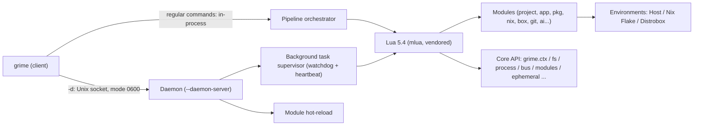

**[ Русский ](README.md) | [ English ](README.en.md)**

# GRIME (Grime-RS)

[](https://github.com/GrimeVoid/grime-rust/releases/tag/v1.1.0)
[](https://www.rust-lang.org/)
[](https://www.lua.org/)
[](https://nixos.org/)
[](https://distrobox.it/)
[](LICENSE)

**GRIME** is a fast command-line orchestrator for Linux developers. It connects project management, isolated Nix Flake environments, Distrobox containers, system package managers, and a universal AI orchestrator (Claude Code, Aider) into a single, predictable CLI workflow.

The main goal of GRIME is to keep your host system clean. Instead of installing dozens of compilers, libraries, and one-off tools directly onto your base OS, you build and run software inside reproducible environments with a single short command.

---

## Why GRIME Exists

When working across multiple languages (C++, Rust, Python, Java, Lua, Bash, Fish), a Linux workstation quickly accumulates conflicting dependencies, multiple compiler versions, and forgotten packages. Tools like Nix, Podman/Distrobox, and custom build scripts solve parts of this problem, but each has its own syntax and friction.

GRIME removes that friction:
- **A clean host OS.** If you need a tool or compiler once, GRIME runs it transparently via Nixpkgs or inside a Distrobox container without leaving clutter on your host.
- **Automatic toolchain synthesis.** Point GRIME at a project directory and run a build — the scanner detects the languages used, generates an ephemeral Nix Flake in the user cache (`~/.cache/grime/`), and builds the project without polluting your repository with boilerplate files.
- **One consistent command standard.** You do not need to memorize separate CLI conventions for `cmake`, `cargo`, `javac`, `nix`, or `distrobox`. Projects, microservices, packages, and Git operations all follow the same rules.
- **True data pipelines.** Chain multiple modules in a single command: resolve a project path, enter a Fedora container, compile the binary, return to the host, and run it.

---

## Principles

- **A user-space microkernel.** The Rust core does only what is common: it parses the command line, builds the pipeline, runs Lua modules, keeps the state bus, and supervises background tasks. Everything else is a module.
- **Modules are the only place that holds domain knowledge.** The core knows nothing about module names, aliases, default paths, or which module switches an environment. A module declares all of it itself with `--@grime key: value` annotations in the header of its `.lua` file (see [documentation.md](documentation.md#2-аннотации-модуля---grime), written in Russian). A new module appears by simply adding a file — no need to rebuild the core.
- **Ephemerality.** Temporary files, build directories, and environments do not linger on the system: temporary resources live in `$XDG_RUNTIME_DIR` and disappear with the session, and the Nix Flake cache is pruned by age.
- **AI agents as part of the pipeline.** Aider and Claude Code plug in through adapters (`modules/agents/`) and work like any other step: they receive the previous step's output and can pass a result on.
- **Safe by default.** System paths are protected from writes and deletion, dangerous operations require an exact name and confirmation, and AI is restricted to an allow-list of actions (see [Security](#security)).

---

## Architecture



1. **Rust microkernel (`grime`).** Parses the command line, builds the pipeline, forwards the working directory and data between steps, provides the shared state bus (`StateBus`) and event bus (`EventBus`), and reports errors uniformly (`[Grime Error]` exactly once; the pipeline is aborted cleanly).
2. **Module runtime — Lua 5.4** (the `mlua` crate, `vendored` build). It is not LuaJIT. Module files are read from disk, compiled to bytecode, and cached (see [Performance](#performance)).
3. **Client-first.** Regular commands run directly inside the `grime` client process, so modules have direct access to the terminal (TTY, interactive TUIs, AI agents, Ctrl+C).
4. **The daemon** (`grime --daemon-server`, managed with `grime daemon`) is used for:
   - detached background tasks started with `-d`/`--detach`, under a supervisor: a watchdog tracks heartbeat events, and a task is **not killed while it still has live child processes** (a long build is not considered hung);
   - module hot-reload: changes in the modules directory are picked up without a restart;
   - the shared state bus and periodic sweeping of orphaned ephemeral directories.
   The client starts the daemon lazily, only when it is actually needed (`-d`).
5. **Modules (`modules/*.lua`).** All logic for compilers, packages, Git, containers, and AI. Modules use the native core API (`grime.ctx`, `grime.fs`, `grime.process`, `grime.bus`, `grime.args`, `grime.fuzzy`, `grime.modules`, `grime.ephemeral`, and others).

### How the core learns about modules

The core knows nothing about specific modules. It only reads comment annotations in the file header (module code is not executed while doing so):

```lua
--@grime description: State bus management
--@grime alias: ls, modules
--@grime requires: module:git, bin:git, module:ai?
--@grime path.projects: ~/Projects
```

Supported keys: `description`, `alias`, `requires`, `boundary`, `wraps`, `chain`, `default`, `path.<name>`. The full format and an example of a custom module are in [documentation.md](documentation.md#2-аннотации-модуля---grime) (in Russian).

---

## Unified Command, Flag, and Pipeline Standard

Every module in GRIME follows the same syntax rules:

- **All flags, actions, and categories strictly start with a dash (`-` or `--`).**
  For example: `-list` (`-ls`), `-path` (`-p`), `-new` (`-n`), `-build` (`-b`), `-run` (`-r`), `-rm`, `-update` (`-u`), `-help` (`-h`), `-rust`, `-cpp`. Any token without a leading dash is treated purely as a positional argument (project or app name, file path, message text, search filter). This ensures names like `test`, `build`, `run`, `list`, or `help` are never accidentally hijacked as commands.
- **Flexible target and flag order.**
  Both `grime project -path grime_pj` and `grime project grime_pj -path` work identically (a partial name is found by fuzzy search). Likewise for micro-apps: `grime app -path my_app` and `grime app my_app -path`.
- **Argument separator `//` (or `--`).**
  To pass flags directly to an external binary without GRIME intercepting them, place `//` before the external arguments:
  ```bash
  grime cmd // echo -n "check"
  ```
- **Global core flags** (before the first module): `-f`/`--force` — ignore step errors, `-d`/`--detach` — run the pipeline as a daemon background task, `-p`/`--path <path>` — base directory of the pipeline, `-h`/`--help`, `-v`/`--version`.
- **Module pipelines with `:`.**
  Steps in a pipeline are separated by a colon `:` (safe in Fish shell, unlike `->` which acts as file redirection). Each step automatically forwards its working directory (`target_dir`), return value (`pipeline_input`), and `StateBus` entries to the next step:
  ```bash
  grime project -path MyService : git -status : bus -set build.ready true
  ```
- **Environment switching (`box` / `nix` and returning via `host`).**
  The `host` module acts as a boundary that returns pipeline execution from a Distrobox container or Nix shell back to the host OS:
  ```bash
  grime project -path MyEngine : box fedora-box : project -build : host : project -run
  ```

---

## Core Modules and Practical Examples

GRIME ships with 14 modules: `project`, `app`, `pkg`, `ai`, `nix`, `box`, `host`, `git`, `list`, `log`, `bus`, `daemon`, `doctor`, `cmd`. The up-to-date help for each one is `grime <module> --help`; the overall list is `grime --help`.

### 1. Project Orchestrator (`project`, alias `proj`)
Manage C++, Rust, Python, Java, Lua, Bash, and Fish projects. Fuzzy directory search, build-system detection, and rebuilds only when sources change (`mtime`). It is the default module (`default: true`): the legacy form `grime --args ...` is handled by it.

```bash
# Create a new project: the language can come before or after the name
grime project init cpp render_core
grime project rust fast_proxy -init
grime project web_crawler -python -init

# Resolve a project path (handy for jumping into a directory)
cd (grime project -path grime_pj)

# Build and run (rebuilds only if the code changed)
grime project -build grime_pj
grime project -run grime_pj

# List projects, rename
grime project -list
grime project --rename OldName NewName

# Removal and reset — exact name only, with confirmation
grime project -rm MyGame            # asks for confirmation
grime project -rm MyGame --yes      # no prompt (required in non-interactive mode)
grime project --clear MyGame --yes  # reset the project to a clean template
```

### 2. Local Micro-Apps (`app`)
Utilities and services, each in its own directory with an `app.lua` manifest and its own `flake.nix` environment. "Zero-manifest" apps are supported too: via a shebang line or a language adapter.

When creating an app (`-new`), simply describe the task in plain language: GRIME detects the stack (`python`, `java`, `rust`, `lua`, `cpp`, `bash`, `fish`) from the text, scaffolds the template, and hands the work to an AI agent (`grime ai`).

```bash
# Create an app with the stack inferred from the description
grime app -new WeatherCli "a Python console app that prints the weather"
grime app -new LogParser -lang rust "a utility for filtering logs"

# Path to an app or to the root of all apps
cd (grime app -path)
grime app -path WeatherCli

# Build and run; -d runs the app in the background (log in app.log)
grime app -build WeatherCli
grime app -run WeatherCli
grime app -run LogParser -d

# Background apps (PID, memory, uptime; state is kept on the bus) and stopping
grime app -ps
grime app -stop LogParser          # -9 / -force — SIGKILL

# Sync the app's flake.nix (git init + generation + git add -N)
grime app -flake WeatherCli

# Compile an app/folder/project into apps and put a symlink in ~/.local/bin
grime app -compile ./my_tool my-tool

# Bundle into a standalone binary (dist/), snapshots and rollback
grime app -bundle WeatherCli
grime app -snapshot WeatherCli "working version"
grime app -diff WeatherCli
grime app -rollback WeatherCli

# App chaining
grime app -run Producer : Consumer
```

### 3. Unified Package Manager (`pkg`)
Combines host package managers (`pacman`, `yay`), `flatpak`, the `nix` profile, `cargo`, `pipx`, `distrobox` containers, and local GRIME apps.

```bash
# Summary table for the active managers
grime pkg

# List packages of a specific manager
grime pkg -yay
grime pkg -flatpak
grime pkg -pacman -list

# Cross-manager fuzzy search
grime pkg ripgrep

# Install and remove (the manager is given explicitly)
grime pkg -i yay neovim
grime pkg -install nix jq
grime pkg -remove flatpak obsidian

# Update: every manager at once, or one
grime pkg -u
grime pkg -u yay

# One-off run without installing on the host (cascade: local -> Distrobox -> ephemeral Nix)
grime pkg -run btop
grime pkg -run nix glow
```

`grime pkg run --help` describes the run cascade rules; `grime pkg -not-found <command>` is the `command-not-found` handler for your shell (see [Build and Install](#build-and-install)).

### 4. Universal AI Orchestrator (`ai`)
Integration of the **Claude Code** and **Aider** AI agents through adapters in `modules/agents/`. The module knows your projects and apps, accepts the output of previous pipeline steps, and can create GRIME apps and modules according to the standard.

The agent is selected with flags (`-claude`, `-aider`, `-agent <name>`), through the bus (`grime bus -set modules.ai.agent <name>`), the `ai_agent` key in `gproj.conf`, or automatically (the first available: `claude`, then `aider`).

```bash
# Interactive or headless (-m) in a project directory
grime ai -claude grime_pj
grime ai -claude grime_pj -m "add unit tests"

# Context from a pipeline
grime project grime_pj -path : git -diff : ai -aider -m "review the changes and suggest a commit message"

# Create a GRIME app or module
grime ai -app JsonTool -lang python "a utility for formatting JSON"
grime ai -module netstat "a module for listing open ports"
```

For Aider, `--no-suggest-shell-commands` is added by default: `--yes-always` must not execute shell commands around GRIME. Safety measures are described in [Security](#security).

### 5. Isolated Nix Environments (`nix`) and Containers (`box`)
The `nix` and `box` modules declare `wraps: pipeline`: the steps after them run inside the corresponding environment until the pipeline returns to the host via the `host` module.

```bash
# Run a command in the project's Nix devShell
grime project -path grime_pj : nix -run cargo test
grime nix -init            # persistent flake.nix with toolchain auto-detection
grime nix -build

# Nix profile and store
grime nix -history
grime nix -rollback --to 3
grime nix -gc              # garbage collection + ephemeral flake cache cleanup
grime nix -optimise

# Distrobox containers
grime box -list
grime box -run fedora-box gcc --version
grime box -export fedora-box --bin /usr/bin/htop

# Switch environment in a pipeline and return to the host
grime project -path MyEngine : box fedora-box : project -build : host : project -run
```

### 6. Infrastructure: `list`, `git`, `log`, `bus`, `daemon`, `doctor`, `cmd`, `host`
```bash
# Ecosystem overview (modules, apps, projects)
grime list
grime list -modules
grime list -apps
grime list -projects

# Git in a pipeline
grime project -path grime_pj : git -status
grime project -path grime_pj : git -snapshot "before refactoring"

# State bus and events
grime bus -set deploy.env production
grime bus -get deploy.env
grime bus -list
grime bus -emit build.done '{"ok":true}'

# Log
grime log -list 20
grime log -errors 5 : ai

# External commands in the current step's directory (alias: exec)
grime project MyGame -path : cmd git status
grime cmd // echo -n "check"

# Daemon: status, restart
grime daemon -status
grime daemon -restart
```

#### Diagnostics and AI repair (`doctor`)
`grime doctor` checks for key tools (git, nix, distrobox, cargo, claude, aider), configured paths, the state of the log, and recent failures.

`grime doctor -fix [-dry] [-yes] [problem description…]` — AI repair:

1. Context is collected (the doctor report, log errors, the last failed command, `journalctl`, failed units, `pacman` state) and **secrets are masked**.
2. You see a summary; after confirmation the context is sent to the agent (the `doctor_agent` key, then `ai_agent`, otherwise `claude`).
3. The agent returns a diagnosis and a `<grime_fix>` script. The script is shown **in full**, with its SHA-256, the lines that escalate privileges, and the risks.
4. It runs **only after an explicit interactive "y"** (the `-yes` flag does not extend to running the script), in a terminal window taken from `$TERMINAL` (default `ghostty`; without a display, the current TTY). The password for plain `sudo` is requested by the system itself: GRIME never sees or stores it.
5. The script lives in an ephemeral directory (0700) and is removed by a `trap` after the window closes.

`-dry` sends and runs nothing — it only shows the summary; `-yes` skips only the confirmation of **sending** the context.

---

## Security

- **System path protection.** The core's file operations (`delete`, `copy`, `move`, `write`) refuse to touch system directories (`/`, `/etc`, `/usr`, `/var`, `/boot`, `/opt`, `/root`, `/nix`, and so on).
- **Destructive commands.** `project -rm` and `project --clear` work only by the **exact** name inside the projects directory. Confirmation (shared `utils.confirm_destructive`) is also required by `app -rm`/`-rollback`, `box -rm`, `nix -gc`, `log -clear`, `bus rm`; in non-interactive mode without `--yes` (`-y`) they all refuse.
- **AI restrictions (`ai`).** Commands from the agent's reply are checked token by token (quoting-aware). `<grime_spawn>` tags are allowed only for an allow-list of modules (`ai`, `cmd`, `app`, `project`, `nix`, `git`, `doctor`, `list`, `log`), and destructive flags (`-rm`, `-clear`, `-rollback`, `-gc`, `-force`, `-purge`, and similar) are forbidden. The AI cannot spawn `pkg`, `box`, `host`, `daemon`, or `bus` directly.
- **`doctor -fix`.** Secrets are scrubbed from the context, the script is shown with its SHA-256, and it runs only after an interactive "y" (see above).
- **The daemon socket** is created with mode `0600`.
- **App manifests** (`app.lua`) are loaded in a sandbox (no `io`, `require`, `load*`, the rest of `os`, `debug`, or `grime`), with a capped instruction count.
- **Cache and ephemeral resources** are created with modes `0700`/`0600`; ownership and the absence of symlinks are verified (see [Ephemerality and Caches](#ephemerality-and-caches)).
- **SIGPIPE.** The client behaves like a classic utility: `grime list | head` exits quietly, without a panic.
- **Config and module lookup** never touches the current directory — you cannot plant a `gproj.conf` or `modules/` in someone else's directory.

---

## Ephemerality and Caches

- **`grime.ephemeral`.** Modules get temporary directories and files through the core API instead of `/tmp`. They are created in `$XDG_RUNTIME_DIR/grime/eph/<pid>-<session>` (mode 0700; without `XDG_RUNTIME_DIR`, in the cache directory under `run/<uid>/eph`). The session holds a `flock` on the `.lock` file; the directory is created lazily and is removed automatically on success, error, cancellation, and a pipeline panic. Orphaned directories (a process killed with `kill -9`) are swept at `grime` start and periodically in the daemon; other users' directories, symlinks, and very fresh ones (under 5 s) are left alone.
- **Nix Flake cache.** Ephemeral flakes live in `~/.cache/grime/flakes/<kind>/<hash>` (`kind` is `env` or `compile`). Directories older than 30 days are removed automatically (checked once a day); `grime nix -gc` additionally cleans this cache.
- **Module index and bytecode.** `~/.cache/grime/modules.idx` is an annotation index (so all modules need not be read at startup), and `~/.cache/grime/bc/` is a cache of compiled Lua bytecode. Both are invalidated by file mtime/size, the GRIME version, and `$HOME`; a corrupted cache is silently rebuilt. The cache root is `$XDG_CACHE_HOME/grime` if the variable is set, otherwise `~/.cache/grime`.

---

## Configuration

### The `gproj.conf` file

A simple `key=value` format (lines starting with `#` or `;` are comments). The template is [config/gproj.conf.example](config/gproj.conf.example).

File lookup order (the first existing one wins):
1. `$GRIME_CONFIG`;
2. `$PROJECT_CONFIG_PATH` (a deprecated variable, kept for compatibility);
3. `$XDG_CONFIG_HOME/grime/gproj.conf` (default `~/.config/grime/gproj.conf`);
4. `<binary dir>/../share/grime/gproj.conf`.

Module directory lookup order:
1. `$GRIME_MODULES`;
2. the `modules=` key from the config;
3. `<config dir>/modules` (default `~/.config/grime/modules`);
4. `<binary dir>/../share/grime/modules`;
5. `<binary dir>/modules`.

Searching the current working directory is **deliberately removed** (security).

Keys:

| Key | Purpose |
| :--- | :--- |
| `config` | Configuration directory (defaults to the directory of the config file) |
| `modules` | Modules directory (defaults to `<config>/modules`) |
| `projects` | Projects root (default declared by the `project` module: `~/Projects`) |
| `templates` | Project templates directory (default from `project`: `~/.config/grime/templates`) |
| `apps` | Micro-apps root (default from `app`: `~/.config/grime/apps`) |
| `distrobox_default` | Default Distrobox container (for example, `fedora-box`) |
| `box_idle_timeout` | Seconds a container may idle before auto-stop (default 300) |
| `nix_allow_unfree` | Allow unfree Nix packages (enabled by default; disable with `false`/`0`/`no`/`off`). Profile installs use `nix profile add` |
| `ai_agent` | Default agent: `claude`, `aider`, or `auto` |
| `doctor_agent` | Agent for `doctor -fix` (then `ai_agent`, otherwise `claude`) |
| `claude`, `aider` | Path to the agent binary, or `auto` |

The core has fixed defaults only for `config` and `modules`; other paths are declared by modules through `path.<name>` annotations, and a config key with the same name overrides them. Values that do not look like paths (`fedora-box`, `300`, `auto`) are kept as is; path values are expanded (`~`, `$VAR`) and normalized, relative ones against the config file's directory. The value `auto` means "unset".

### Environment variables

| Variable | Purpose |
| :--- | :--- |
| `GRIME_CONFIG` | Path to `gproj.conf` |
| `PROJECT_CONFIG_PATH` | Deprecated synonym of `GRIME_CONFIG` |
| `GRIME_MODULES` | Modules directory (takes priority over the config) |
| `GRIME_STATE_FILE` | Persistent state bus file (default `~/.config/grime/state.json`) |
| `XDG_CONFIG_HOME` | Base configuration directory |
| `XDG_CACHE_HOME` | Base cache directory (`<...>/grime`) |
| `XDG_RUNTIME_DIR` | Daemon socket (`grime.sock`) and ephemeral resources |
| `TERMINAL` | Terminal for `doctor -fix` (default `ghostty`) |
| `GRIME_BIN` | Path to `grime` for self-invocation from the `ai` module (otherwise the current binary) |

---

## Roadmap / Not Implemented Yet

The following is **not done yet** and is listed only as a direction:

- An IPC data bus between programs written in different languages: typed data streams between steps and external processes (today steps exchange a string/`PipelinePayload` and state bus values).
- Automatic `stderr` capture via a shell hook (today the terminal context is passed manually with `grime daemon -feed`; shell hooks exist for `command-not-found`).
- Lazy API registration: today all `grime.*` tables are created when the Lua state is initialized.

---

## Developer Documentation and API

A detailed reference is available for writing your own modules (annotations, hooks, the core Lua API, configuration):
- [Module and Lua API reference (documentation.md)](documentation.md) — written in Russian.

---

## Performance

GRIME is a small native binary (about 2.6 MB in a release build). Cold-start measurements on the developer's machine (50 runs after 3 warm-up runs, median; two series on a differently loaded machine are shown as a range):

| Command | Median |
| :--- | :---: |
| `grime --version` | ≈ 1.1–1.9 ms |
| `grime --help` | ≈ 1.3–1.6 ms |
| `grime exec true` | ≈ 4.2–4.5 ms (p95 ≈ 6.8 ms) |
| `grime host` | ≈ 3.2 ms |
| `grime doctor` | ≈ 7 ms (was ≈ 13–15.7 ms before the native `which`) |
| `grime list` | ≈ 8–16 ms (dominated by the Lua `list` module itself) |

The "under 5 ms" target holds for `--version`, `--help`, and simple modules (`exec true`) by median, not for every command. These are measurements from a single machine, not a guarantee: timing depends on hardware, the filesystem, the number of modules, and what the module itself does. Modules that call external programs (`git`, `nix`, `distrobox`) are bounded by the speed of those programs.

What was sped up:
- **On-disk module index** (`~/.cache/grime/modules.idx`): annotations are not re-read on every start.
- **Bytecode cache** (`~/.cache/grime/bc/`): module sources are not re-parsed.
- **`current_thread` client runtime**: no worker pool and no CPU-count probing; the multi-threaded runtime is used only by the daemon.
- **Native `which`** (`grime.process.which`: walks `$PATH` without spawning processes; also used when checking `requires: bin:`).
- **Fast `--version` and `--help` paths**: they do not need pipeline parsing (`--version` needs neither the config nor the module registry).

---

## Development and Tests

Run from the repository without installing:

```bash
cargo build --release
GRIME_MODULES=$PWD/modules target/release/grime list
```

Tests:

```bash
cargo test                              # Rust unit and integration tests
lua5.4 tests/lua/valid_name_test.lua    # Lua module tests: one file from tests/lua/ at a time
```

Tests are isolated: the core's unit tests use a temporary isolated root for the cache and ephemeral resources (the real `~/.cache` and `$XDG_RUNTIME_DIR` are not touched), and the state bus in test binaries lives in memory unless `GRIME_STATE_FILE` is set. For manual experiments you can isolate the environment like this:

```bash
GRIME_CONFIG=/tmp/g/gproj.conf GRIME_STATE_FILE=/tmp/g/state.json \
XDG_CACHE_HOME=/tmp/g/cache XDG_RUNTIME_DIR=/tmp/g/run grime list
```

---

## Build and Install

### Build with Nix Flake
```bash
nix build .#static     # static build (the `static` package in flake.nix)
nix build              # regular build (the `default` package)
nix develop            # development environment
```

### Build with Cargo
```bash
cargo build --release
```

### The `install.sh` script
`./install.sh` looks for a ready binary (`target/release/grime`, `result/bin/grime`, then an already installed one), builds it if missing (`cargo`, otherwise `nix`), installs it into the binary directory, deploys modules and templates into the config directory, sets up `command_not_found` hooks, and finally runs `grime doctor`.

| Option | Effect |
| :--- | :--- |
| `-s`, `--symlink` | Create symlinks to modules and templates instead of copying them (developer mode) |
| `-b`, `--build` | Force a build before installing |
| `--bin-dir <DIR>` | Binary directory (default `$XDG_BIN_HOME` or `~/.local/bin`) |
| `--config-dir <DIR>` | Configuration directory (default `$XDG_CONFIG_HOME/grime` or `~/.config/grime`) |
| `--no-hook` | Do not set up `command_not_found` hooks (Fish/Bash/Zsh) |
| `-h`, `--help` | Help |

Without installing, straight from the repository: `GRIME_MODULES=$PWD/modules target/release/grime <module>`.

After installing a new version, restart the background daemon and verify the environment:
```bash
grime daemon -restart
grime doctor
```

### Catching unknown commands
`install.sh` sets up the hook itself (unless `--no-hook` is given). For Fish, manually, in `~/.config/fish/functions/fish_command_not_found.fish`:
```fish
function fish_command_not_found
    grime pkg -not-found --no-confirm -- $argv
end
```

---

## License

This project is distributed under the terms of the **[MIT License](LICENSE)**.  
Copyright (c) 2026 **GrimeVoid**.
