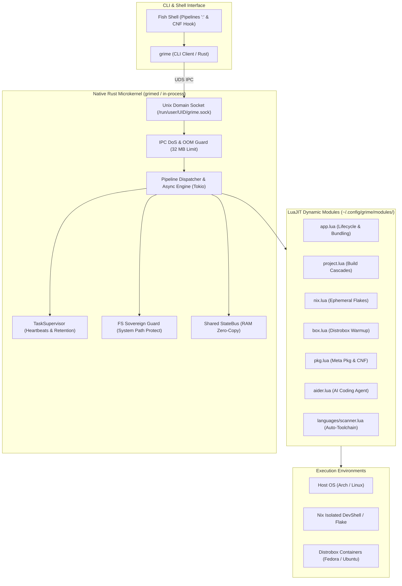

**[ 🇷🇺 Русский ](README.md) • [ 🇬🇧 English ](README.en.md)**

# GRIME (Next Generation / Grime-RS) 🦀🌙

[](https://github.com/ValetJk010/Grime_Project/releases/tag/v1.1.0)
[](https://www.rust-lang.org/)
[](https://luajit.org/)
[](https://nixos.org/)
[](https://distrobox.it/)
[-brightgreen.svg)]()
[](LICENSE)

> **Высокопроизводительный системный оркестратор проектов, контейнеров и эфемерных Nix-окружений на стыке нативного Rust и встраиваемого LuaJIT.**

**GRIME** кардинально решает проблему «работает на моей машине», фрагментации сборочных инструментов и тяжеловесности контейнеризации. Он объединяет герметичность **Nix Flakes**, гибкость изолированных дистрибутивов **Distrobox** и скорость нативного ядра **Rust** в единый декларативный конвейер данных с субмиллисекундным временем реакции.

Начиная с версии **v1.1.0**, ядро GRIME эволюционировало в **промышленное сверхнадёжное микроядро (Production-Grade Resilient Microkernel)**. Вся предметная логика, адаптеры языков и сборочные стратегии полностью вынесены в декларативные динамические модули LuaJIT, а ядро Rust сфокусировано исключительно на управлении жизненным циклом, асинхронном пайплайнинге, супервизии задач, IPC и бескомпромиссной безопасности исполнения.

---

## 🎯 Технологический стек

| Компонент | Технология | Обоснование выбора |
| :--- | :--- | :--- |
| **Системное микроядро** | **Rust (Edition 2021)**, Tokio, mlua | Полная типобезопасность, Zero-Cost Abstractions, отсутствие сборщика мусора и минимальный footprint памяти (~4.2 МБ RAM в простое). Чистая микроядерная архитектура. |
| **Скриптовый движок** | **LuaJIT FFI / mlua** | Моментальное исполнение логики модулей, безопасность песочницы, поддержка Hot-Reload без перезапуска процессов. |
| **Герметичные окружения** | **Nixpkgs / Nix Flakes** | Математически воспроизводимые зависимости, дедупликация на уровне жестких ссылок и нулевое загрязнение хост-системы. |
| **Контейнеризация** | **Distrobox / Podman / Docker** | Бесшовная интеграция с любыми Linux-дистрибутивами (Fedora, Ubuntu, Arch, Alpine) с разделением X11/Wayland, PipeWire и сокетов. |
| **Межпроцессное взаимодействие** | **Unix Domain Sockets (UDS)** + StateBus | Отклик 1–2 мс между CLI-клиентом и фоновым демоном, защита от DoS/OOM (лимит сообщений 32 МБ) и Zero-Copy передача буферов (`bytes::Bytes`). |

---

## ⚡ Ключевые архитектурные возможности

### 1. Интеллектуальный мультиязычный сканер и Auto-Toolchain
GRIME избавляет разработчика от ручной установки компиляторов и сборочных систем. Встроенный сканер (`languages/scanner.lua`) анализирует исходный код проекта (C++, Rust, Python, Java, Lua, Go) и структуру файлов (`CMakeLists.txt`, `Cargo.toml`, `Makefile`, `pom.xml`):
- Автоматически формирует точный сборочный граф.
- Определяет компиляторы, линкеры и сборочные утилиты для `nativeBuildInputs`.
- Бесшовно объединяет авто-тулчейн со специфическими системными библиотеками (`special_dependencies = { "openssl", "raylib", "boost" }`).

### 2. Эфемерные Nix Flake окружения (Zero Dirty Tree)
Сборка проектов происходит в изолированных средах Nix без загрязнения корня репозитория:
- Синтез эфемерных Flake-описаний в пользовательском кэше (`~/.cache/grime/flakes/<hash>/`).
- Никаких паразитных `flake.nix`, `flake.lock` или `.direnv` в рабочей директории проекта.
- Автоматическая изоляция от системных пакетов хоста и гарантированная воспроизводимость сборки на любой машине.

### 3. Оркестрация микросервисов и полиглотных приложений (`grime app`)
GRIME предоставляет полноценный жизненный цикл для микросервисов и полиглотных связок:
- Декларативное описание в компактных манифестах `app.lua`.
- Управление демонами: запуск в фоне (`--detach`), мониторинг PID, перезапуск и сбор логов.
- Поддержка полиглотных стеков: например, высокопроизводительное C++ ядро вычислений, управляемое скриптами анализа на Python с передачей данных через потоковые каналы или IPC.

### 4. Автономные самораспаковывающиеся бандлы (Nix Closures & Bundles)
Команда `grime app bundle <app>` генерирует автономный самодостаточный исполняемый файл в каталоге `dist/`:
- Запекает все runtime-зависимости (включая glibc, интерпретатор Python, динамические библиотеки) в единый переносимый бинарник.
- Готовый бинарник запускается на любом Linux-дистрибутиве без установленного Nix, компиляторов или зависимостей.

### 5. Бесшовные конвейеры сред (Host ↔ Distrobox ↔ Nix)
GRIME позволяет строить непрерывные конвейеры с переходом границ окружений за один вызов:
```bash
grime project cpp init MyGame : box fedora-box : project build : host : project run
```
- Шаги конвейера разделяются двоеточием `:`.
- Бесшовная передача контекста выполнения, переменных окружения и файловых дескрипторов между средами.
- Рубежный модуль `host` безопасно возвращает контекст на хост-машину.

### 6. Шина состояния StateBus (`grime bus`) и двойной аудит (Git + Nix)
- **StateBus**: Потокобезопасная шина в оперативной памяти демона для обмена метаданными между модулями без парсинга stdout. Поддерживает автоматическую RAII-очистку пространства `pipeline.*` после завершения конвейера и персистентное состояние.
- **Двойной аудит**: Команда `grime app diff <app>` одновременно инспектирует как изменения в исходном коде через `git diff`, так и расхождения в структуре собранных пакетов и замыканий Nix через `nix store diff-closures`.
- **Снимки и мгновенный откат**: `grime app snapshot <app> "ревизия"` и `grime app rollback <app>`.

### 7. Сверхнадёжное промышленное микроядро (Hardened Resilient Microkernel v1.1.0)
В ядре реализован комплекс критических защитных механизмов операционного уровня:
- **Защита IPC от DoS и OOM**: строгий лимит размера передаваемых сообщений 32 МБ с мгновенным отсечением повреждённых сокетных фреймов и защитой от исчерпания памяти хоста.
- **Интеллектуальный супервизор задач (`TaskSupervisor`)**:
  - Защита от ложных таймаутов на долгих шагах сборки (`is_step_active`): пока компилятор или шаг конвейера активно работает, таймаут не прерывает задачу.
  - Автоматическая очистка завершённых задач старше 1 часа (Retention Policy) для предотвращения утечек дескрипторов и памяти.
  - Самовосстановление после отравления блокировок (Mutex Poison Recovery) — сбой отдельного потока не приводит к падению фонового демона `grimed`.
- **Суверенитет файловой системы и защита системных путей**: безусловный запрет любых деструктивных файловых операций над системными директориями (`/`, `/etc`, `/usr`, `/nix`, `/var`, `/boot`, `/root`), а также запрет разыменования симлинков при изменении прав (`chmod`), предотвращающий privilege escalation и атаки по ссылкам.
- **Защита от переполнения стека (Stack Overflow Guard)**: жёсткое ограничение глубины обхода при сериализации графов таблиц Lua в JSON (`max_depth = 64`), предотвращающее краши из-за циклических ссылок.
- **Нативная поддержка TUI и PTY**: канонический проброс дескрипторов псевдотерминала (`Stdio::inherit`) обеспечивает 100% совместимость с интерактивными TUI-утилитами (`cava`, `btop`, `nvim`, `less`, сплит-интерфейсами).

### 8. Интерактивный Command-Not-Found для Fish Shell (`grime pkg not-found`)
Интеллектуальный хук командной оболочки Fish, превращающий терминал в самовосстанавливающуюся среду разработки:
1. **Прозрачная локальная проверка**: при вводе команды GRIME мгновенно проверяет установленные пакеты Flatpak, изолированные приложения Grime Apps (`~/.config/grime/apps/<cmd>`), бинарники Nix Profile (`~/.nix-profile/bin/`) и Cargo (`~/.cargo/bin/`). Если утилита обнаружена локально — она запускается немедленно без дополнительных подтверждений.
2. **Интерактивный запуск через Nix**: если утилита отсутствует на хосте, но доступна в репозитории Nixpkgs, GRIME вежливо выводит запрос:
   ```text
   [Grime] Команда 'htop' не найдена на хосте.
   Найдена в репозитории Nixpkgs. Запустить в изолированном окружении? [Y/n]: 
   ```
   При согласии команда мгновенно запускается в эфемерном окружении `nix-shell` без загрязнения хост-системы.
3. **Нечёткий поиск при опечатках (Fuzzy Did-You-Mean)**: если утилита не найдена нигде, алгоритм Дамерау-Левенштейна моментально подбирает наиболее близкую по звучанию команду среди установленных в системе бинарников:
   ```text
   [Grime] Команда 'carg' не найдена.
   💡 Возможно, вы имели в виду: cargo?
   ```

---

## 🏗️ Архитектура системы



---

---

## 📊 Производительность и системные метрики

Абсолютные показатели времени отклика и системных накладных расходов:

| Метрика | Значение | Описание и условия замера |
| :--- | :--- | :--- |
| **Холодный старт CLI (`grime`)** | **`3.6 мс`** | От вызова процесса до инициализации LuaJIT VM и парсинга конвейера |
| **Отклик через сокет демона** | **`1.1 мс`** | Полный roundtrip запрос-ответ через Unix Domain Socket |
| **Потребление RAM в простое** | **`4.2 МБ`** | Постоянный RSS фонового сервиса `grimed` |
| **Синтез эфемерного Flake** | **`< 15 мс`** | Хеширование проекта, синтез тулчейна и кэширование devShell |

---

## 🚀 Быстрый старт

### 1. Сборка и установка

#### Через Nix Flake (Рекомендуемый герметичный способ):
```bash
# Сборка статического бинарника без внешних runtime-зависимостей:
nix build .#static

# Или запуск готового dev-окружения:
nix develop
```

#### Классическая сборка через Cargo:
```bash
cargo build --release
```
Бинарные файлы будут доступны в:
- `target/release/grime` — легковесный CLI-клиент.
- `target/release/grimed` — резидентный фоновый демон.

Установка в пользовательский `PATH`:
```bash
cp target/release/grime target/release/grimed ~/.local/bin/
```

### 2. Запуск фонового демона (опционально)
```bash
# Фоновый запуск сервиса:
grimed --daemon

# Проверка работоспособности ядра и всех модулей:
grime doctor
```
*(Если демон не запущен, утилита `grime` автоматически исполняет команды локально в том же процессе без потери функционала).*

---

## 💡 Примеры реальных сценариев

### Сборка C++ проекта через каскад компиляторов в эфемерном Nix Flake:
```bash
# Интеллектуальный каскад: CMakeLists.txt -> Makefile -> прямой g++/clang++
grime project cpp init FastService
grime nix build FastService
```

### Бесшовный конвейер сквозь среды и контейнеры:
```bash
# Создание проекта -> Сборка в контейнере Fedora -> Возврат на хост -> Запуск
grime project rust MicroCli path : box fedora-box : project build : host : project run
```

### Создание и демонизация микросервиса:
```bash
# Инициализация сервиса из шаблона
grime app new telemetry-agent --lang rust

# Фоновый запуск с контролем PID
grime app run telemetry-agent --detach

# Проверка статуса всех активных сервисов
grime app list

# Остановка сервиса
grime app stop telemetry-agent
```

### Упаковка полиглотного приложения в автономный переносимый бинарник:
```bash
# Компиляция C++ ядра, запекание Python логики и всех зависимостей в dist/polyapp
grime app bundle polyapp

# Запуск готового независимого бандла на любой машине:
./apps/polyapp/dist/polyapp
```

### Синхронизация состояния через StateBus:
```bash
grime bus set build.target "release-v2" : log INFO "Флаг установлен" : bus get build.target
```

---

## 📝 Спецификация манифеста приложения (`app.lua`)

Каждое изолированное приложение или микросервис декларируется файлом `app.lua`:

```lua
return {
    -- Идентификация приложения
    name = "compute-worker",
    version = "1.0.0",
    description = "Высокопроизводительный воркер аналитики",
    type = "polyglot", -- cpp, rust, python, java, polyglot, generic

    -- Сборочные инструкции и артефакт
    build = "g++ -O3 src/engine.cpp -o engine",
    artifact = "engine",
    run = "./engine",
    sources = { "src/engine.cpp", "scripts/analyzer.py" },

    -- Авто-тулчейн и специальные зависимости Nixpkgs
    special_dependencies = {
        "openssl",
        "boost",
        "python3"
    },

    -- Настройки фонового режима (демонизации)
    detached = false,
    env = {
        LOG_LEVEL = "info",
        WORKER_THREADS = "4"
    }
}
```

---

## 🛠️ Состав модулей расширения

Репозиторий включает декларативные модули LuaJIT (`modules/`), каждый из которых реализует специализированную системную область:

- [`modules/app.lua`](modules/app.lua) — Полный жизненный цикл приложений, демонизация, снапшоты Git, аудит Nix-замыканий и автономный бандлинг.
- [`modules/project.lua`](modules/project.lua) — Оркестрация исходных проектов разработчика, fuzzy-поиск директорий, проверка актуальности mtime.
- [`modules/languages/`](modules/languages/) — Адаптеры для C++, Rust, Python, Java с интеллектуальным сканером структуры [`scanner.lua`](modules/languages/scanner.lua).
- [`modules/nix.lua`](modules/nix.lua) — Декларативные и эфемерные окружения Nix Flake/DevShell, сборка мусора (`gc`), дедупликация (`optimise`).
- [`modules/box.lua`](modules/box.lua) — Оркестрация и выполнение команд внутри изолированных Distrobox-контейнеров.
- [`modules/pkg.lua`](modules/pkg.lua) — Унифицированный мульти-менеджер пакетов (Pacman, Flatpak, Nix, Distrobox, Cargo), нечёткий поиск и интерактивный Command-Not-Found.
- [`modules/daemon.lua`](modules/daemon.lua) — Управление фоновым сервисом `grimed`: статус, мониторинг памяти, проверка сокета, перезапуск и сбор диагностических логов.
- [`modules/aider.lua`](modules/aider.lua) — Интеграция автономного AI-агента кодогенерации и рефакторинга Aider непосредственно в пайплайн Grime.
- [`modules/bus.lua`](modules/bus.lua) — Разделяемая память StateBus между шагами конвейера.
- [`modules/git.lua`](modules/git.lua) — Высокоуровневые операции Git, аудит изменений и снапшоты.
- [`modules/doctor.lua`](modules/doctor.lua) — Глубокая диагностика доступных системных инструментов и контейнеров.
- [`modules/log.lua`](modules/log.lua) — Структурированное системное журналирование.

---

## 🐚 Совместимость с командными оболочками и интеграция с Fish Shell

### 1. Синтаксис конвейеров
Конвейеры GRIME используют двоеточие `:` как универсальный разделитель шагов:
```fish
grime host : bus set system.mode production : git status : log INFO "Аудит завершен"
```
> **Совет для пользователей Fish Shell:** Символ `:` предотвращает перехват токена `->` оболочкой Fish (который в Fish интерпретируется как перенаправление потока в файл).

### 2. Подключение Command-Not-Found в Fish Shell
Чтобы Fish автоматически подхватывал отсутствующие команды через изолированный Nix-рантайм или подсказывал правильное имя утилиты:
```fish
# Создание функции перехвата в Fish Shell:
mkdir -p ~/.config/fish/functions
echo 'function fish_command_not_found
    grime pkg not-found $argv
end' > ~/.config/fish/functions/fish_command_not_found.fish
```
После этого любая неизвестная команда в шелле будет обрабатываться интерактивным менеджером GRIME с предложением запуска через Nix `[Y/n]` или нечёткими подсказками при опечатках.

---

## 📄 Лицензия

Проект распространяется под двойной лицензией **[GRIME Dual License](LICENSE)**:
- **Личное, образовательное и исследовательское использование:** Полностью бесплатно, бессрочно и без ограничений ([PolyForm Noncommercial 1.0](LICENSE)).
- **Коммерческое использование:** Роялти 1% от валового дохода, с льготным порогом до $50,000/год для независимых разработчиков и малых стартапов (бесплатно до превышения порога).

Подробные условия и юридический текст доступны в файле [LICENSE](LICENSE).  
Автор: **ValetJk010**
