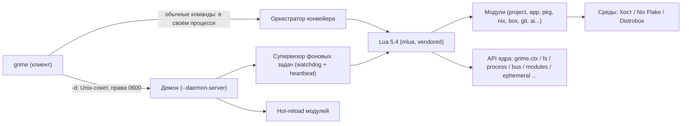

**[ Русский ](README.md) | [ English ](README.en.md)**

# GRIME (Grime-RS)

[](https://github.com/GrimeVoid/grime-rust/releases/tag/v1.1.0)
[](https://www.rust-lang.org/)
[](https://www.lua.org/)
[](https://nixos.org/)
[](https://distrobox.it/)
[](LICENSE)

**GRIME** — это быстрый консольный оркестратор для разработчика на Linux. Он связывает управление проектами, изолированные окружения Nix Flakes, контейнеры Distrobox, системные пакетные менеджеры и универсальный AI-оркестратор (Claude Code, Aider) в единый предсказуемый инструмент командной строки.

Главная цель GRIME — избавить основную систему от беспорядка. Вместо того чтобы ставить десятки компиляторов, библиотек и разовых утилит прямо на хост, вы запускаете и собираете код в изолированных воспроизводимых средах одной короткой командой.

---

## Зачем нужен GRIME и какую проблему он решает

При активной разработке на нескольких языках (C++, Rust, Python, Java, Lua, Bash, Fish) рабочая система быстро обрастает конфликтующими зависимостями, разными версиями компиляторов и забытыми пакетами. Для решения этой проблемы обычно используют Nix, контейнеры Podman/Distrobox и разные сборочные скрипты, но у каждого из них свой синтаксис и свои особенности.

GRIME убирает эту рутину:
- **Чистая хост-система.** Если программа или компилятор нужны на один раз, GRIME прозрачно запустит их через Nixpkgs или внутри контейнера Distrobox, не оставляя следов в системе.
- **Автоматический подбор тулчейна.** Достаточно открыть папку с кодом и вызвать сборку — сканер сам определит языки проекта, сгенерирует окружение Nix Flake в кэше (`~/.cache/grime/`) и соберёт проект без засорения репозитория лишними файлами.
- **Единый язык команд.** Вам не нужно помнить десятки флагов `cmake`, `cargo`, `javac`, `nix` или `distrobox`. Все операции с проектами, сервисами, пакетами и Git подчиняются одной логике.
- **Настоящие конвейеры данных.** Разные модули можно выстраивать в цепочки в одну строку: найти путь к проекту, переключиться в контейнер Fedora, собрать бинарник, вернуться на хост и запустить его.

---

## Принципы

- **Микроядро в пользовательском пространстве.** Ядро на Rust делает только общее: разбирает командную строку, строит конвейер, исполняет Lua-модули, хранит шину состояния, следит за фоновыми задачами. Всё остальное — модули.
- **Модули — единственное место знаний о предметной области.** Ядро не знает ни имён модулей, ни их алиасов, ни путей по умолчанию, ни того, какой модуль сменяет среду. Всё это модуль объявляет сам аннотациями `--@grime key: value` в шапке своего `.lua`-файла (см. [documentation.md](documentation.md#2-аннотации-модуля---grime)). Новый модуль появляется простым добавлением файла — ядро пересобирать не нужно.
- **Эфемерность.** Временные файлы, каталоги сборки и окружения не оседают в системе: временные ресурсы живут в `$XDG_RUNTIME_DIR` и удаляются вместе с сессией, а кэш Nix Flake чистится по возрасту.
- **ИИ-агенты как часть конвейера.** Aider и Claude Code подключаются адаптерами (`modules/agents/`) и работают наравне с остальными шагами: получают вывод предыдущего шага и могут передать результат следующему.
- **Безопасность по умолчанию.** Системные пути защищены от записи и удаления, опасные операции требуют точного имени и подтверждения, ИИ ограничен белым списком действий (см. [Безопасность](#безопасность)).

---

## Архитектура



1. **Микроядро на Rust (`grime`).** Разбирает командную строку, строит конвейер шагов, передаёт между шагами рабочий каталог и данные, обеспечивает общую шину состояния (`StateBus`) и событий (`EventBus`) и единообразно выводит ошибки (`[Grime Error]` ровно один раз; конвейер аккуратно прерывается).
2. **Рантайм модулей — Lua 5.4** (крейт `mlua`, встроенная сборка `vendored`). Это не LuaJIT. Файлы модулей читаются с диска, компилируются в байткод и кэшируются (см. [Производительность](#производительность)).
3. **Client-first.** Обычные команды выполняются прямо в процессе клиента `grime`: у модулей есть прямой доступ к терминалу (TTY, интерактивные TUI, ИИ-агенты, Ctrl+C).
4. **Демон** (`grime --daemon-server`, управление — `grime daemon`) нужен для:
   - фоновых открепляемых (detached) задач, запускаемых флагом `-d`/`--detach`, под присмотром супервизора: watchdog следит за heartbeat-событиями, и задача **не убивается, пока у неё есть живые дочерние процессы** (долгая сборка не считается зависшей);
   - hot-reload модулей: изменения в каталоге модулей подхватываются без перезапуска;
   - общей шины состояния и периодического подметания осиротевших эфемерных каталогов.
   Клиент поднимает демон лениво, только когда он действительно нужен (`-d`).
5. **Модули (`modules/*.lua`).** Вся логика работы с компиляторами, пакетами, Git, контейнерами и ИИ. Модули используют нативный API ядра (`grime.ctx`, `grime.fs`, `grime.process`, `grime.bus`, `grime.args`, `grime.fuzzy`, `grime.modules`, `grime.ephemeral` и др.).

### Как ядро узнаёт о модулях

Ядро ничего не знает о конкретных модулях. Оно читает только комментарии-аннотации в шапке файла (код модуля при этом не исполняется):

```lua
--@grime description: Управление шиной состояния
--@grime alias: ls, modules
--@grime requires: module:git, bin:git, module:ai?
--@grime path.projects: ~/Projects
```

Поддерживаются: `description`, `alias`, `requires`, `boundary`, `wraps`, `chain`, `default`, `path.<имя>`. Полное описание, формат и пример собственного модуля — в [documentation.md](documentation.md#2-аннотации-модуля---grime).

---

## Единый стандарт команд, флагов и конвейеров

Чтобы интерфейс оставался интуитивным во всех модулях, в GRIME действует единый стандарт синтаксиса:

- **Все флаги, действия и категории строго начинаются со знака минус (`-` или `--`).**
  Например: `-list` (`-ls`), `-path` (`-p`), `-new` (`-n`), `-build` (`-b`), `-run` (`-r`), `-rm`, `-update` (`-u`), `-help` (`-h`), `-rust`, `-cpp`. Любой токен без знака минус безоговорочно трактуется как позиционный аргумент (название проекта или микроприложения, путь, текст сообщения, поисковый фильтр). Это гарантирует, что сущности с именами `test`, `build`, `run`, `list`, `help` никогда не будут ложно восприняты как команды.
- **Свободный порядок сущности и флага действия.**
  Вы можете писать как `grime project -path grime_pj`, так и `grime project grime_pj -path` — оба варианта сработают одинаково и найдут проект даже по неполному имени (fuzzy-поиск). Точно так же для микроприложений: `grime app -path my_app` и `grime app my_app -path`.
- **Разделитель аргументов `//` (или `--`).**
  Если нужно передать внешней программе её собственные флаги, чтобы ядро GRIME их не перехватывало, поставьте перед ними `//`:
  ```bash
  grime cmd // echo -n "проверка"
  ```
- **Глобальные флаги ядра** (до первого модуля): `-f`/`--force` — игнорировать ошибки шагов, `-d`/`--detach` — запустить конвейер фоновой задачей демона, `-p`/`--path <путь>` — базовый каталог конвейера, `-h`/`--help`, `-v`/`--version`.
- **Конвейеры модулей через двоеточие `:`.**
  Шаги в одной команде соединяются знаком `:` (в оболочке Fish символ `->` является перенаправлением в файл, поэтому `:` — основной и безопасный разделитель). Каждый шаг автоматически передаёт следующему рабочую директорию (`target_dir`), возвращаемый результат (`pipeline_input`) и данные через `StateBus`:
  ```bash
  grime project -path MyService : git -status : bus -set build.ready true
  ```
- **Переключение сред (`box` / `nix` и возврат через `host`).**
  Модуль `host` служит рубежом, который возвращает выполнение из контейнера Distrobox или окружения Nix обратно на основную ОС:
  ```bash
  grime project -path MyEngine : box fedora-box : project -build : host : project -run
  ```

---

## Основные модули и примеры использования

В поставке 14 модулей: `project`, `app`, `pkg`, `ai`, `nix`, `box`, `host`, `git`, `list`, `log`, `bus`, `daemon`, `doctor`, `cmd`. Актуальную справку каждого модуля показывает `grime <модуль> --help`; общий список — `grime --help`.

### 1. Оркестратор проектов (`project`, алиас `proj`)
Управление проектами на C++, Rust, Python, Java, Lua, Bash и Fish. Нечёткий поиск папок, автоопределение системы сборки, пересборка только при изменении исходников (`mtime`). Модуль по умолчанию (`default: true`): старая форма `grime --args ...` обрабатывается именно им.

```bash
# Создать новый проект: язык можно указать до или после имени
grime project init cpp render_core
grime project rust fast_proxy -init
grime project web_crawler -python -init

# Найти путь к проекту (удобно для перехода в директорию)
cd (grime project -path grime_pj)

# Собрать и запустить (пересборка — только если код изменился)
grime project -build grime_pj
grime project -run grime_pj

# Список проектов, переименование
grime project -list
grime project --rename OldName NewName

# Удаление и сброс — только по точному имени и с подтверждением
grime project -rm MyGame            # спросит подтверждение
grime project -rm MyGame --yes      # без вопроса (обязательно в неинтерактивном режиме)
grime project --clear MyGame --yes  # сбросить проект к чистому шаблону
```

### 2. Локальные микроприложения (`app`)
Утилиты и сервисы, каждый в своей директории с манифестом `app.lua` и собственным окружением `flake.nix`. Поддерживаются и приложения «без манифеста»: по shebang-строке или по адаптеру языка.

При создании (`-new`) достаточно описать задачу человеческим языком: GRIME распознает стек (`python`, `java`, `rust`, `lua`, `cpp`, `bash`, `fish`) из текста, развернёт шаблон и поручит ИИ-агенту (`grime ai`) написать код.

```bash
# Создать приложение с автовыбором стека из текста описания
grime app -new WeatherCli "консольное приложение на Python для вывода погоды"
grime app -new LogParser -lang rust "утилита для фильтрации логов"

# Путь к приложению или к корню всех приложений
cd (grime app -path)
grime app -path WeatherCli

# Сборка и запуск; -d запускает приложение в фоне (лог в app.log)
grime app -build WeatherCli
grime app -run WeatherCli
grime app -run LogParser -d

# Фоновые приложения (PID, память, uptime; состояние хранится в шине) и остановка
grime app -ps
grime app -stop LogParser          # -9 / -force — SIGKILL

# Синхронизировать flake.nix приложения (git init + генерация + git add -N)
grime app -flake WeatherCli

# Скомпилировать приложение/папку/проект в apps и положить симлинк в ~/.local/bin
grime app -compile ./my_tool my-tool

# Упаковка в автономный бинарник (dist/), снимки и откат
grime app -bundle WeatherCli
grime app -snapshot WeatherCli "рабочая версия"
grime app -diff WeatherCli
grime app -rollback WeatherCli

# Цепочки приложений
grime app -run Producer : Consumer
```

### 3. Единый менеджер пакетов (`pkg`)
Объединяет пакетные менеджеры хоста (`pacman`, `yay`), `flatpak`, профиль `nix`, `cargo`, `pipx`, контейнеры `distrobox` и локальные приложения GRIME.

```bash
# Сводная таблица по активным менеджерам
grime pkg

# Список пакетов конкретного менеджера
grime pkg -yay
grime pkg -flatpak
grime pkg -pacman -list

# Сквозной нечёткий поиск пакета сразу везде
grime pkg ripgrep

# Установка и удаление (менеджер указывается явно)
grime pkg -i yay neovim
grime pkg -install nix jq
grime pkg -remove flatpak obsidian

# Обновление: всех менеджеров сразу или одного
grime pkg -u
grime pkg -u yay

# Разовый запуск без установки на хост (каскад: локально -> Distrobox -> эфемерный Nix)
grime pkg -run btop
grime pkg -run nix glow
```

`grime pkg run --help` описывает правила каскада запуска; `grime pkg -not-found <команда>` — обработчик `command-not-found` для оболочки (см. [Сборка и установка](#сборка-и-установка)).

### 4. Универсальный ИИ-оркестратор (`ai`)
Интеграция ИИ-агентов **Claude Code** и **Aider** через адаптеры в `modules/agents/`. Модуль знает структуру ваших проектов и приложений, принимает вывод предыдущих шагов конвейера, умеет создавать приложения и модули GRIME по стандарту.

Агент выбирается флагами (`-claude`, `-aider`, `-agent <имя>`), через шину (`grime bus -set modules.ai.agent <имя>`), ключом `ai_agent` в `gproj.conf` или автоматически (первый доступный: `claude`, затем `aider`).

```bash
# Интерактивно или headless (-m) в директории проекта
grime ai -claude grime_pj
grime ai -claude grime_pj -m "добавь юнит-тесты"

# Контекст из конвейера
grime project grime_pj -path : git -diff : ai -aider -m "проверь изменения и предложи сообщение коммита"

# Создать приложение или модуль GRIME
grime ai -app JsonTool -lang python "утилита для форматирования JSON"
grime ai -module netstat "модуль для просмотра открытых портов"
```

Для Aider по умолчанию добавляется `--no-suggest-shell-commands`: `--yes-always` не должен исполнять shell в обход GRIME. Меры безопасности — в разделе [Безопасность](#безопасность).

### 5. Изолированные окружения Nix (`nix`) и контейнеры (`box`)
Модули `nix` и `box` объявляют `wraps: pipeline`: шаги после них исполняются внутри соответствующей среды, пока конвейер не вернётся на хост модулем `host`.

```bash
# Выполнить команду в devShell Nix для проекта
grime project -path grime_pj : nix -run cargo test
grime nix -init            # постоянный flake.nix с автоопределением тулчейна
grime nix -build

# Профиль и хранилище Nix
grime nix -history
grime nix -rollback --to 3
grime nix -gc              # сборка мусора + очистка кэша эфемерных flake
grime nix -optimise

# Контейнеры Distrobox
grime box -list
grime box -run fedora-box gcc --version
grime box -export fedora-box --bin /usr/bin/htop

# Смена среды в конвейере и возврат на хост
grime project -path MyEngine : box fedora-box : project -build : host : project -run
```

### 6. Инфраструктура: `list`, `git`, `log`, `bus`, `daemon`, `doctor`, `cmd`, `host`
```bash
# Обзор экосистемы (модули, приложения, проекты)
grime list
grime list -modules
grime list -apps
grime list -projects

# Git в конвейере
grime project -path grime_pj : git -status
grime project -path grime_pj : git -snapshot "перед рефакторингом"

# Шина состояния и события
grime bus -set deploy.env production
grime bus -get deploy.env
grime bus -list
grime bus -emit build.done '{"ok":true}'

# Журнал
grime log -list 20
grime log -errors 5 : ai

# Внешние команды в каталоге текущего шага (алиас: exec)
grime project MyGame -path : cmd git status
grime cmd // echo -n "проверка"

# Демон: статус, перезапуск
grime daemon -status
grime daemon -restart
```

#### Диагностика и ИИ-ремонт (`doctor`)
`grime doctor` проверяет наличие ключевых утилит (git, nix, distrobox, cargo, claude, aider), пути из конфигурации, состояние журнала и недавние сбои.

`grime doctor -fix [--dry] [--yes] [описание проблемы…]` — ИИ-ремонт:

1. Собирается контекст (отчёт doctor, ошибки журнала, последняя упавшая команда, `journalctl`, упавшие юниты, состояние `pacman`), **секреты маскируются**.
2. Вы видите сводку; после подтверждения контекст уходит агенту (ключ `doctor_agent`, затем `ai_agent`, иначе `claude`).
3. Агент возвращает диагноз и скрипт `<grime_fix>`. Скрипт показывается **целиком**, с SHA-256, списком строк с повышением привилегий и рисками.
4. Запуск — **только после явного интерактивного «y»** (флаг `--yes` на запуск скрипта не распространяется), в окне терминала из `$TERMINAL` (по умолчанию `ghostty`; без дисплея — текущий TTY). Пароль у обычного `sudo` запрашивает сама система: GRIME пароль не видит и не хранит.
5. Скрипт лежит в эфемерном каталоге (0700) и удаляется по `trap` после закрытия окна.

`--dry` ничего не отправляет и не запускает — только показывает сводку и промпт; `--yes` пропускает подтверждение именно **отправки** контекста.

---

## Безопасность

- **Защита системных путей.** Файловые операции ядра (`delete`, `copy`, `move`, `write`) отказываются работать с системными каталогами (`/`, `/etc`, `/usr`, `/var`, `/boot`, `/opt`, `/root`, `/nix` и т. п.).
- **Деструктивные команды проектов.** `project -rm` и `project --clear` работают только по **точному** имени внутри каталога проектов и спрашивают подтверждение; в неинтерактивном режиме без `--yes` отказываются.
- **Ограничения для ИИ (`ai`).** Команды из ответа агента проверяются по токенам (с учётом кавычек). Теги `<grime_spawn>` разрешены только для белого списка модулей (`ai`, `cmd`, `app`, `project`, `nix`, `git`, `doctor`, `list`, `log`), причём разрушительные флаги (`-rm`, `-clear`, `-rollback`, `-gc`, `-force`, `-purge` и подобные) запрещены. Модули `pkg`, `box`, `host`, `daemon`, `bus` ИИ напрямую порождать не может.
- **`doctor -fix`.** Чистка секретов из контекста, показ скрипта с SHA-256, запуск только после интерактивного «y» (см. выше).
- **Сокет демона** создаётся с правами `0600`.
- **Манифесты приложений** (`app.lua`) читаются в песочнице (без `io`, `require`, `load*`, остального `os`, `debug`, `grime`), число инструкций ограничено.
- **Кэш и эфемерные ресурсы** создаются с правами `0700`/`0600`; проверяются владелец и отсутствие симлинков (см. [Эфемерность и кэши](#эфемерность-и-кэши)).
- **SIGPIPE.** Клиент ведёт себя как классическая утилита: `grime list | head` завершается тихо, без паники.
- **Поиск конфигурации и модулей** не обращается к текущему каталогу — подложить `gproj.conf` или `modules/` в чужой каталог нельзя.

---

## Эфемерность и кэши

- **`grime.ephemeral`.** Модули получают временные каталоги и файлы через API ядра, а не через `/tmp`. Они создаются в `$XDG_RUNTIME_DIR/grime/eph/<pid>-<session>` (права 0700; без `XDG_RUNTIME_DIR` — в каталоге кэша `run/<uid>/eph`). Сессия держит `flock` на файле `.lock`; каталог создаётся лениво и удаляется автоматически при успехе, ошибке, отмене и панике конвейера. Осиротевшие каталоги (процесс убит `kill -9`) подметаются при старте `grime` и периодически в демоне; чужие каталоги, симлинки и слишком свежие (младше 5 с) не трогаются.
- **Кэш Nix Flake.** Эфемерные flake лежат в `~/.cache/grime/flakes/<kind>/<hash>` (`kind` — `env` или `compile`). Каталоги старше 30 суток удаляются автоматически (проверка раз в сутки); `grime nix -gc` дополнительно чистит этот кэш.
- **Индекс модулей и байткод.** `~/.cache/grime/modules.idx` — индекс аннотаций (чтобы не читать все модули при старте), `~/.cache/grime/bc/` — кэш скомпилированного байткода Lua. Оба кэша инвалидируются по mtime/размеру файлов, версии GRIME и `$HOME`; повреждённый кэш молча пересобирается. Корень кэша — `$XDG_CACHE_HOME/grime`, если переменная задана, иначе `~/.cache/grime`.

---

## Конфигурация

### Файл `gproj.conf`

Простой формат `ключ=значение` (строки с `#` и `;` — комментарии). Шаблон — [config/gproj.conf.example](config/gproj.conf.example).

Порядок поиска файла (берётся первый существующий):
1. `$GRIME_CONFIG`;
2. `$PROJECT_CONFIG_PATH` (устаревшая переменная, оставлена для совместимости);
3. `$XDG_CONFIG_HOME/grime/gproj.conf` (по умолчанию `~/.config/grime/gproj.conf`);
4. `<каталог бинаря>/../share/grime/gproj.conf`.

Порядок поиска каталога модулей:
1. `$GRIME_MODULES`;
2. ключ `modules=` из конфига;
3. `<каталог конфигурации>/modules` (по умолчанию `~/.config/grime/modules`);
4. `<каталог бинаря>/../share/grime/modules`;
5. `<каталог бинаря>/modules`.

Поиск в текущем рабочем каталоге **намеренно убран** (безопасность).

Ключи:

| Ключ | Назначение |
| :--- | :--- |
| `config` | Каталог конфигурации (по умолчанию — каталог файла конфигурации) |
| `modules` | Каталог модулей (по умолчанию `<config>/modules`) |
| `projects` | Корень проектов (умолчание объявляет модуль `project`: `~/Projects`) |
| `templates` | Каталог шаблонов проектов (умолчание модуля `project`: `~/.config/grime/templates`) |
| `apps` | Корень микроприложений (умолчание модуля `app`: `~/.config/grime/apps`) |
| `distrobox_default` | Контейнер Distrobox по умолчанию (например, `fedora-box`) |
| `box_idle_timeout` | Простой контейнера в секундах до автоостановки (по умолчанию 300) |
| `ai_agent` | Агент по умолчанию: `claude`, `aider` или `auto` |
| `doctor_agent` | Агент для `doctor -fix` (затем `ai_agent`, иначе `claude`) |
| `claude`, `aider` | Путь к бинарю агента или `auto` |

Ядро имеет фиксированные умолчания только для `config` и `modules`; остальные пути объявляют модули аннотациями `path.<имя>`, а ключ конфига с тем же именем их переопределяет. Значения, не похожие на путь (`fedora-box`, `300`, `auto`), остаются как есть; значения-пути раскрываются (`~`, `$VAR`) и нормализуются, относительные — от каталога файла конфигурации. Значение `auto` равносильно «не задано».

### Переменные окружения

| Переменная | Назначение |
| :--- | :--- |
| `GRIME_CONFIG` | Путь к `gproj.conf` |
| `PROJECT_CONFIG_PATH` | Устаревший синоним `GRIME_CONFIG` |
| `GRIME_MODULES` | Каталог модулей (приоритетнее конфига) |
| `GRIME_STATE_FILE` | Файл персистентной шины состояния (по умолчанию `~/.config/grime/state.json`) |
| `XDG_CONFIG_HOME` | Базовый каталог конфигурации |
| `XDG_CACHE_HOME` | Базовый каталог кэша (`<...>/grime`) |
| `XDG_RUNTIME_DIR` | Сокет демона (`grime.sock`) и эфемерные ресурсы |
| `TERMINAL` | Терминал для `doctor -fix` (по умолчанию `ghostty`) |
| `GRIME_BIN` | Путь к `grime` для самозапуска из модуля `ai` (иначе — путь текущего бинаря) |

---

## Дорожная карта / ещё не реализовано

Следующее **пока не сделано** и приведено только как направление развития:

- IPC-шина данных между программами на разных языках: типизированные потоки между шагами и внешними процессами (сейчас шаги обмениваются строкой/`PipelinePayload` и значениями шины состояния).
- Автоматический перехват `stderr` хуком оболочки (сейчас контекст терминала передаётся вручную через `grime daemon -feed`; для `command-not-found` хуки оболочек есть).
- Ленивая регистрация API: сейчас все таблицы `grime.*` создаются при инициализации Lua-состояния.

---

## Документация разработчика и API

Для создания собственных модулей (аннотации, хуки, Lua API ядра, конфигурация) подготовлен подробный справочник:
- [Справочник по модулям и Lua API ядра GRIME (documentation.md)](documentation.md)

---

## Производительность

GRIME — небольшой нативный бинарь (около 2,6 МБ в релизной сборке). Замеры холодного старта на машине разработчика (50 прогонов после 3 прогревочных, медиана; две серии при разной загрузке машины указаны диапазоном):

| Команда | Медиана |
| :--- | :---: |
| `grime --version` | ≈ 1,1–1,9 мс |
| `grime --help` | ≈ 1,3–1,6 мс |
| `grime exec true` | ≈ 4,2–4,5 мс (p95 ≈ 6,8 мс) |
| `grime host` | ≈ 3,2 мс |
| `grime doctor` | ≈ 7 мс (было ≈ 13–15,7 мс до нативного `which`) |
| `grime list` | ≈ 8–16 мс (основное время — сам Lua-модуль `list`) |

Планка «меньше 5 мс» выполняется по медиане для `--version`, `--help` и простых модулей (`exec true`), но не для каждой команды. Это замеры одной машины, а не гарантия: время зависит от железа, файловой системы, числа модулей и работы самого модуля. Модули, вызывающие внешние программы (`git`, `nix`, `distrobox`), ограничены скоростью этих программ.

Что ускорено:
- **Индекс модулей на диске** (`~/.cache/grime/modules.idx`): аннотации не перечитываются при каждом запуске.
- **Кэш байткода** (`~/.cache/grime/bc/`): исходники модулей не разбираются заново.
- **`current_thread` runtime клиента**: без пула воркеров и опроса числа CPU; многопоточный runtime только у демона.
- **Нативный `which`** (`grime.process.which`: обход `$PATH` без порождения процессов; используется и при проверке `requires: bin:`).
- **Быстрые пути `--version` и `--help`**: не требуют разбора конвейера (для `--version` не нужны ни конфиг, ни реестр модулей).

---

## Разработка и тесты

Запуск из репозитория без установки:

```bash
cargo build --release
GRIME_MODULES=$PWD/modules target/release/grime list
```

Тесты:

```bash
cargo test                              # юнит- и интеграционные тесты Rust
lua5.4 tests/lua/valid_name_test.lua    # Lua-тесты модулей: по одному файлу из tests/lua/
```

Тесты изолированы: юнит-тесты ядра работают во временном изолированном корне кэша и эфемерных ресурсов (реальные `~/.cache` и `$XDG_RUNTIME_DIR` не затрагиваются), а шина состояния в тестовых бинарях живёт в памяти, если не задан `GRIME_STATE_FILE`. Для ручных экспериментов окружение можно изолировать так:

```bash
GRIME_CONFIG=/tmp/g/gproj.conf GRIME_STATE_FILE=/tmp/g/state.json \
XDG_CACHE_HOME=/tmp/g/cache XDG_RUNTIME_DIR=/tmp/g/run grime list
```

---

## Сборка и установка

### Сборка через Nix Flake
```bash
nix build .#static     # статическая сборка (пакет `static` во flake.nix)
nix build              # обычная сборка (пакет `default`)
nix develop            # окружение разработки
```

### Сборка через Cargo
```bash
cargo build --release
```

### Скрипт `install.sh`
`./install.sh` ищет готовый бинарь (`target/release/grime`, `result/bin/grime`, затем уже установленный), при отсутствии собирает его (`cargo`, иначе `nix`), устанавливает в каталог бинарей, разворачивает модули и шаблоны в каталог конфигурации, настраивает хуки `command_not_found` и в конце запускает `grime doctor`.

| Опция | Действие |
| :--- | :--- |
| `-s`, `--symlink` | Вместо копирования модулей и шаблонов создать симлинки (режим разработчика) |
| `-b`, `--build` | Принудительно собрать бинарь перед установкой |
| `--bin-dir <DIR>` | Каталог для бинаря (по умолчанию `$XDG_BIN_HOME` или `~/.local/bin`) |
| `--config-dir <DIR>` | Каталог конфигурации (по умолчанию `$XDG_CONFIG_HOME/grime` или `~/.config/grime`) |
| `--no-hook` | Не настраивать хуки `command_not_found` (Fish/Bash/Zsh) |
| `-h`, `--help` | Справка |

Без установки, прямо из репозитория: `GRIME_MODULES=$PWD/modules target/release/grime <модуль>`.

После установки новой версии перезапустите фоновый демон и проверьте окружение:
```bash
grime daemon -restart
grime doctor
```

### Перехват неизвестных команд
`install.sh` сам настраивает хук (если не указан `--no-hook`). Вручную для Fish — в `~/.config/fish/functions/fish_command_not_found.fish`:
```fish
function fish_command_not_found
    grime pkg -not-found --no-confirm -- $argv
end
```

---

## Лицензия

Проект распространяется на условиях лицензии **[MIT License](LICENSE)**.  
Copyright (c) 2026 **GrimeVoid**.
