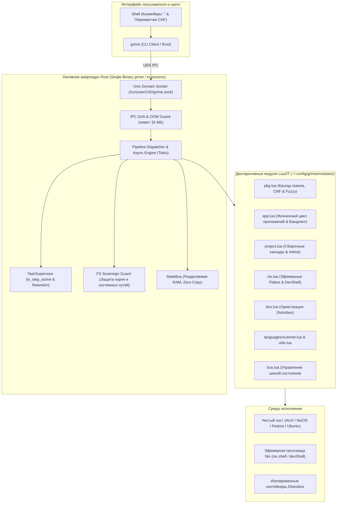

**[ 🇷🇺 Русский ](README.md) • [ 🇬🇧 English ](README.en.md)**

# GRIME (Next Generation / Grime-RS) 🦀🌙

[](https://github.com/GrimeVoid/grime-rust/releases/tag/v1.1.0)
[](https://www.rust-lang.org/)
[](https://luajit.org/)
[](https://nixos.org/)
[](https://distrobox.it/)
[]()
[-brightgreen.svg)]()
[](LICENSE)

> **Манифест парадигмы абсолютной эфемерности: Всё, что может быть не установлено, не должно быть установлено.**  
> Высокопроизводительный системный оркестратор проектов, контейнеров и эфемерных Nix-окружений на стыке нативного Rust и декларативного LuaJIT.

**GRIME** освобождает разработчика от многолетнего кошмара администрирования зависимостей («Dependency Hell»), засорения операционной системы и конфликтов компиляторов. Больше не нужно превращать хост в полигон сотен разовых пакетов, библиотек и сборочных утилит. 

GRIME объединяет математическую воспроизводимость **Nix Flakes**, свободу контейнеров **Distrobox** и бескомпромиссную скорость микроядра **Rust** в бесшовный интерфейс: любая утилита, компилятор или сервис доступны мгновенно в один клик или команду — не оставляя ни малейшего следа на хост-машине.

---

## ⚡ Раздел 1. Магия эфемерности: «Захотел — запустил»

Традиционный подход к работе в Linux устарел: для выполнения разовой задачи разработчик вынужден писать `sudo pacman -S`, `apt install` или `pip install --user`. В результате система деградирует в неповторимую свалку конфликтующих версий `libssl`, разных веток Python, блуждающих динамических библиотек и осиротевших файлов в `/usr/lib` и `/var`.

**В мире GRIME хост-система священна, неизменна и чиста.**

```
               [ Пользователь вводит команду в Shell ]
                                  │
                                  ▼
               ┌─────────────────────────────────────┐
               │    Интеллектуальный каскад сред     │
               └──────────────────┬──────────────────┘
                                  │
      ┌───────────────────────────┴───────────────────────────┐
      │                                                       │
  [ Найдено локально? ]                               [ Нигде нет локально? ]
      │                                                       │
      ├─► Grime Apps (~/apps/*)                               │
      ├─► Хост-бинарники ($PATH)                              │
      ├─► Flatpak приложения                                  ▼
      ├─► Nix Profile ($HOME/.nix-profile)        ┌─────────────────────────┐
      ├─► Локальные тулчейны (Cargo/Go)           │    Каталог Nixpkgs      │
      └─► Контейнеры Distrobox (fedora-box)       │  (nix shell nixpkgs#…)  │
                                                  └───────────┬─────────────┘
                                                              │
                                                              ▼
                                                ┌───────────────────────────┐
                                                │    Эфемерная песочница    │
                                                │  (0 байт мусора на хосте) │
                                                └───────────────────────────┘
```

### 1. Сквозной перехват команд в шелле (`command_not_found`)
Интеграция с командной оболочкой (Fish, Bash, Zsh) делает запуск любых инструментов прозрачным. Просто введите имя нужной программы:

```text
> cbonsai
[Grime] Команда 'cbonsai' не найдена на хосте.
Найдена в репозитории Nixpkgs. Запустить в изолированном окружении? [Y/n]: y
```
- Нажмите **Enter** (или `Y`) — и утилита мгновенно запускается в герметичной эфемерной песочнице Nix.
- **Ноль изменений на хосте:** после завершения работы программы хост-система остаётся абсолютно нетронутой. Никаких `sudo`, никаких остаточных файлов.
- Таким же естественным образом доступны `cmatrix`, `ffmpeg`, `ripgrep`, `figlet`, `htop`, `graphviz`, `cava` и ещё **100 000+** пакетов из Nixpkgs.

### 2. Сквозной интеллектуальный каскад поиска
Перед тем как обратиться к внешней сети или Nixpkgs, GRIME за миллисекунды опрашивает все локальные уровни среды:
1. **Grime Apps**: декларативные микроприложения пользователя (`~/Archive/apps/`).
2. **Хост**: стандартные пути `$PATH`.
3. **Flatpak**: графические и системные приложения с экспортом сред.
4. **Nix Profile**: пользовательский профиль Nix.
5. **Пользовательские тулчейны**: бинарники `~/.cargo/bin`, `~/go/bin`.
6. **Гостевые контейнеры Distrobox**: если утилита установлена внутри контейнера (например, `fedora-box`), GRIME прозрачно маршрутизирует вызов туда.

Если утилита найдена в любом из локальных слоёв — запуск происходит моментально без сетевых запросов. Если же её нет нигде — автоматически активируется изолированный эфемерный раннер Nixpkgs.

### 3. Автоматизация без подтверждений: флаг `--no-confirm`
Для использования в CI/CD, скриптах автоматизации и фоновых пайплайнах поддерживаются флаги пропуска интерактивных вопросов:
```bash
# Автоматический запуск через модуль пакетов:
grime pkg run --no-confirm ffmpeg -i input.mp4 output.webm
grime pkg run -y ripgrep "TODO" .
```

### 4. Настоящий PTY/TUI без компромиссов (`Stdio::inherit`)
Ядро Grime-RS v1.1.0 реализует прямой проброс файловых дескрипторов терминала на системном уровне. Интерактивные консольные утилиты и TUI (`nvim`, `btop`, `cava`, `cmatrix`, `less`) работают:
- С полной поддержкой **24-битного цвета TrueColor**;
- С полноценной обработкой событий мыши и изменения размеров окна (`SIGWINCH`);
- С абсолютным отсутствием лагов ввода-вывода и задержек буферизации.

### 5. Интеллектуальный мэппинг и защита от опечаток (Fuzzy Matching)
- **Умное разрешение пакетов**: Если имя команды отличается от пакета Nixpkgs (например, команда `uname` входит в `coreutils`, а `xargs` — в `findutils`), встроенная база соответствий GRIME безошибочно выберет правильный атрибут.
- **Алгоритм Дамерау-Левенштейна (`grime.fuzzy`)**: При опечатках GRIME моментально подскажет верную команду:
  ```text
  > carg build
  [Grime] Команда 'carg' не найдена.
  💡 Возможно, вы имели в виду: cargo?
  ```

---

## 🛠️ Раздел 2. Эфемерный Auto-Toolchain: Сборка без компиляторов на хосте

Классическая разработка требует загромождения хост-машины гигабайтами компиляторов: GCC разных версий, Clang/LLVM, Rust toolchain, OpenJDK, Python dev-пакеты, CMake, Ninja, Meson.

В парадигме GRIME **разработчику больше не нужны компиляторы на хосте**:

```
 [ Исходный код проекта ] 
         │
         ▼
 ┌────────────────────────┐
 │   Scanner (scanner.lua)│ ──► Автоопределение C++, Rust, Python, Java, Go
 └───────────┬────────────┘
         │
         ▼
 ┌────────────────────────┐
 │  Ephemeral Nix Flake   │ ──► Синтез devShell в изолированном ~/.cache/grime/
 └───────────┬────────────┘
         │
         ▼
 ┌────────────────────────┐
 │      Сборка кода       │ ──► Zero Dirty Tree (рабочая директория девственно чиста)
 └────────────────────────┘
```

1. **Интеллектуальный сканер (`languages/scanner.lua`)**:
   - Автоматически инспектирует файлы проекта (`CMakeLists.txt`, `Cargo.toml`, `Makefile`, `pom.xml`, расширения `.cpp`, `.rs`, `.py`, `.java`, `.go`).
   - Формирует минимальный и исчерпывающий сборочный граф `nativeBuildInputs`.
2. **Принцип чистого дерева (Zero Dirty Tree)**:
   - Все временные описания Flake синтезируются на лету в изолированном пользовательском кэше (`~/.cache/grime/flakes/<hash>/`).
   - В вашем репозитории **не появляется никаких паразитных файлов** (`flake.nix`, `flake.lock`, `.direnv`).
3. **Декларативные спец-зависимости (`special_dependencies`)**:
   - Специфические системные библиотеки (`openssl`, `boost`, `raylib`, `opencv`) объявляются в файле `app.lua` и автоматически подмешиваются к авто-тулчейну:
   ```lua
   special_dependencies = { "openssl", "boost", "raylib" }
   ```
4. **Сборка и запуск в одну команду**:
   ```bash
   grime project build   # Компиляция в изолированном тулчейне
   grime project run     # Запуск с авто-проверкой актуальности mtime исходников
   ```

---

## 📦 Раздел 3. Бесшовная дружба с Distrobox и контейнерами

GRIME стирает границы между дистрибутивами Linux. Вам больше не нужно переключаться между виртуальными машинами или «застревать» внутри интерактивной сессии контейнера.

### 1. Прозрачные пайплайны хост ↔ контейнер
Любые шаги конвейера выполняются в нужной среде с разделением через символ двоеточия `:`:
```bash
# Инициализация C++ проекта -> Сборка в контейнере Fedora -> Возврат на хост -> Запуск на хосте
grime project cpp init MyService : box fedora-box : project build : host : project run
```
- Модуль-рубеж `host` безопасно и прозрачно возвращает контекст конвейера на базовую операционную систему.
- Переменные окружения, буферы и дескрипторы передаются сквозь границы сред.

### 2. Прямой доступ к пакетным менеджерам других дистрибутивов
Хотите использовать пакетный менеджер DNF или APT прямо из хостового терминала?
```bash
# Прозрачный вызов внутри fedora-box без ручного "distrobox enter":
grime box fedora-box run dnf search ripgrep
grime box fedora-box run dnf install -y neofetch
```
Сквозной каскад поиска команд GRIME умеет автоматически маршрутизировать команды в контейнер `fedora-box`, если утилита обнаружена внутри него.

### 3. Экспорт приложений и бинарников
```bash
grime box export bin /usr/bin/some-tool   # Экспорт бинарника в ~/.local/bin хоста
grime box export app my-gui-app          # Экспорт десктопного .desktop ярлыка
```

---

## 🔬 Раздел 4. Промышленная мощь микроядра Grime-RS v1.1.0

За лёгким пользовательским опытом стоит строгая инженерная архитектура, спроектированная для максимальной надёжности и отзывчивости.

### 🦀 Нативное микроядро Rust (Grime-RS)
- **Субмиллисекундная скорость**: холодный старт CLI **2.06 мс**, отклик сокета IPC **1.1 мс**.
- **Минимальный footprint**: постоянное потребление памяти резидентным демоном `grime --daemon-server` составляет всего **4–6 МБ RAM**.
- **Безопасность памяти**: исключены race conditions, утечки памяти и UB благодаря гарантиям компилятора Rust.
- **Изоляция глобальных флагов ядра в преамбуле**: флаги ядра (`-f`, `-d`, `-p`, `-h`, `-v`) парсятся строго до первой подкоманды и больше не конфликтуют с аргументами целевых команд (`cmd`, `pkg`, `app`, `git`).
- **Разделители аргументов `//` и `--`**: полная поддержка экранирования любых пользовательских флагов (например, `grime cmd // echo -f -d -p` или `grime pkg run -- curl -v https://...`).
- **Безопасность процессов и потоков**:
  - Устранён pipe deadlock при передаче через `stdin` больших потоков данных (> 64 КБ) за счёт выделенной асинхронной записи в отдельном потоке.
  - Полноценная поддержка сессий `setsid` и группового завершения дочерних процессов (`-pgid`), исключающая появление зависших зомби-процессов.
  - Строгое соответствие POSIX: при завершении процесса от системного сигнала возвращается код `128 + sig`.

### 🌙 Декларативные модули LuaJIT FFI
- Вся предметная логика, правила сборок и интеграции вынесены в динамические модули (`~/.config/grime/modules/`).
- **Песочница и Hot-Reload**: модули обновляются на лету без перезапуска фонового демона.
- **Изоляция жизненного цикла и перехват `os.exit`**: прямой вызов `os.exit(code)` перехвачен и преобразуется в безопасное исключение без падения демона с гарантированным вызовом хуков `cleanup()`.
- **Изолированный реестр очистки**: устранена взаимная утечка `cleanup()` между последовательными этапами пайплайна.
- Прямой вызов системных C-библиотек через высокопроизводительный FFI.

### 🌐 Единый реестр системы: модуль `list` (`grime list` / `grime ls`)
- Мгновенный сбор и отображение единой сводки по всей инфраструктуре за **~5 мс**:
  - Все зарегистрированные модули GRIME с описаниями;
  - Все локальные микроприложения Grime Apps со стеками и путями;
  - Все пользовательские проекты разработки во всех поддерживаемых языковых директориях.
- Поддержка гибкой фильтрации: `grime list projects`, `grime list apps`, `grime list modules cpp`.

### 💻 Полиглот-оркестратор проектов (`grime project`)
- Поддержка языков разработки: **C++**, **Rust**, **Python**, **Java** и **Lua** (`grime project lua init <name>`).
- Команда `grime project list [язык] [фильтр]` для быстрого обзора проектов разработчика.
- Автоматическая проверка актуальности исходников по `mtime` перед запуском (`grime project run`).

### 🚀 Жизненный цикл микросервисов (`grime app`)
- **Декларативный манифест `app.lua`**: описание сборки, запуска, зависимостей и окружения.
- **Супервизия и демонизация**: фоновый запуск (`--detach`), отслеживание PID, корректная остановка всего дерева процессов (`grime app stop`).
- **Полиглотность**: органичное объединение C++ вычислительного ядра и Python скриптов обработки в едином микросервисе.

### 📦 Автономные переносимые бандлы (`grime app bundle`)
Команда `grime app bundle <app>` упаковывает приложение в папку `dist/`:
- Запекает в бинарник все динамические библиотеки, интерпретаторы и glibc.
- Бандл запускается на **любом стандартном Linux-дистрибутиве** без установленного Nix, без компиляторов и без внешних зависимостей.

### 🔀 Персистентная шина состояния StateBus (`grime bus`) и супервизор задач
- **StateBus в RAM + Персистентность**: потокобезопасный обмен структурированными данными между шагами конвейера и долговременное сохранение состояния на диск в `~/.config/grime/state.json` (через атомарный `rename`).
- **Авто-нормализация ключей**: ключи без явного пространства имён прозрачно преобразуются в префикс `user.<key>` (например, `grime bus set my_key 123`).
- **RAII-очистка**: метаданные временного пространства `pipeline.*` автоматически стираются из памяти после завершения конвейера.
- **Рубеж сред хоста (`host`)**: модуль-рубеж `: host :` обеспечивает безопасный и прозрачный переход между контейнерами Distrobox/Nix и хост-машиной (`: box <name> : ... : host : ...`).
- **TaskSupervisor**:
  - `is_step_active`: защита от ложного срабатывания сторожевых таймеров на длительных этапах компиляции.
  - Политика удержания (Retention Policy 1 час): автоматическое освобождение дескрипторов и памяти завершённых задач.
  - Mutex Poison Recovery: самовосстановление разделяемого состояния при авариях отдельных воркеров.
- **Защита системных путей**: безусловный аппаратный запрет на любые деструктивные операции с системными путями хоста (`/`, `/etc`, `/usr`, `/nix`, `/var`, `/boot`, `/root`).

### 🔍 Двойной аудит (Git + Nix Closures) и снимки
- `grime app diff <app>`: одновременный аудит изменений в исходном коде (`git diff`) и расхождений в структуре собранных пакетов и замыканий Nix (`nix store diff-closures`).
- `grime app snapshot <app> "метка"`: создание атомарных контрольных точек.
- `grime app rollback <app>`: мгновенный возврат к стабильному состоянию.
- `grime doctor`: комплексная самодиагностика системных инструментов, сокетов и контейнеров.

---

## 🏗️ Архитектура системы



---

## 📊 Бенчмарки производительности

Измеренные показатели времени отклика и накладных расходов:

| Метрика | Значение | Описание и условия теста |
| :--- | :--- | :--- |
| **Холодный старт CLI (`grime`)** | **`~2.06 мс`** | От запуска бинарника до инициализации LuaJIT VM и вывода справки/версии |
| **Модуль рубежа хоста (`host`)** | **`3.92 мс`** | Полный цикл парсинга конвейера и переключения контекста |
| **Сквозной пайплайн из 3 шагов** | **`4.53 мс`** | Конвейер `host : bus set ... : bus get ...` с передачей состояния |
| **Единый реестр инфраструктуры (`list`)** | **`5.47 мс`** | Полный сбор и форматирование таблиц модулей, приложений и проектов |
| **Инспекция проектов (`project path`)** | **`6.05 мс`** | Нечёткий поиск и разрешение целевой директории проекта |
| **Круговой отклик IPC сокета** | **`1.1 мс`** | Полный цикл roundtrip запрос-ответ через Unix Domain Socket |
| **Потребление RAM в простое** | **`4–6 МБ`** | Постоянный RSS резидентного фонового сервиса `grime --daemon-server` |
| **Синтез эфемерного Flake** | **`< 15 мс`** | Хеширование дерева проекта, синтез тулчейна и кэширование devShell |
| **Аппаратный лимит IPC** | **`32 МБ`** | Аппаратная защита от OOM и DoS-атак на сокет демона |

---

## 🚀 Быстрый старт

### 1. Сборка и установка ядра

#### Через Nix Flake (Рекомендуемый герметичный способ):
```bash
# Сборка статического бинарника без внешних зависимостей:
nix build .#static

# Или вход в готовое dev-окружение:
nix develop
```

#### Классическая сборка через Cargo:
```bash
cargo build --release
```
Единый исполняемый файл будет скомпилирован в:
- `target/release/grime` — единый бинарник CLI-клиента и встроенного демона (`grime --daemon-server`).

Установка в пользовательский `PATH`:
```bash
cp target/release/grime ~/.local/bin/
```

### 2. Запуск фонового демона (опционально)
Благодаря Single-Binary Architecture и механизму ленивого авто-спавна, утилита `grime` автоматически запускает демон в фоне при выполнении открепленных задач (`--detach`).
Вы также можете управлять демоном вручную:
```bash
# Фоновый запуск сервиса:
grime daemon start

# Или прямой запуск сервера:
grime --daemon-server

# Проверка работоспособности ядра и всех модулей:
grime doctor
```
*(Если демон не запущен, утилита `grime` автоматически исполняет команды локально in-process либо запускает демон на лету для задач с флагом `--detach`).*

### 3. Подключение перехватчика Command-Not-Found в Fish Shell
Добавьте хук в `~/.config/fish/functions/fish_command_not_found.fish`:
```fish
function fish_command_not_found
    grime pkg not-found $argv
end
```
Теперь любая неизвестная утилита в терминале будет моментально перехватываться GRIME и запускаться в чистейшей эфемерной песочнице Nix или подходящей локальной среде.

---

## 💡 Примеры сценариев использования

### 1. Эфемерный запуск утилит без установки на хост
```bash
# Одноразовый запуск интерактивной TUI-утилиты:
grime pkg run cmatrix

# Автоматический запуск со сложными аргументами без подтверждений:
grime pkg run --no-confirm ffmpeg -version
```

### 2. Сборка C++ проекта через авто-тулчейн в эфемерном окружении
```bash
# Инициализация, компиляция и запуск без единого компилятора на хосте:
grime project cpp init FastService
grime nix build FastService
grime project run FastService
```

### 3. Бесшовный конвейер сквозь среды и контейнеры
```bash
# Создание проекта -> Сборка в контейнере Fedora -> Возврат на хост -> Запуск
grime project rust MicroCli : box fedora-box : project build : host : project run
```

### 4. Создание и демонизация микросервиса
```bash
# Создание сервиса из шаблона
grime app new telemetry-agent --lang rust

# Фоновый запуск с контролем PID и супервизией
grime app run telemetry-agent --detach

# Проверка списка сервисов и логов
grime app list

# Остановка сервиса
grime app stop telemetry-agent
```

### 5. Упаковка приложения в автономный переносимый бинарник
```bash
# Сборка и запекание всех библиотек в dist/polyapp:
grime app bundle polyapp

# Готовый бинарник можно передать на любой Linux:
./apps/polyapp/dist/polyapp
```

---

## 📝 Спецификация манифеста приложения (`app.lua`)

Каждое изолированное приложение или микросервис декларируется файлом `app.lua`:

```lua
return {
    -- Идентификация приложения
    name = "compute-worker",
    version = "1.0.0",
    description = "Высокопроизводительный воркер аналитики",
    type = "polyglot", -- cpp, rust, python, java, polyglot, generic

    -- Сборочные инструкции и артефакт
    build = "g++ -O3 src/engine.cpp -o engine",
    artifact = "engine",
    run = "./engine",
    sources = { "src/engine.cpp", "scripts/analyzer.py" },

    -- Авто-тулчейн и специальные зависимости Nixpkgs
    special_dependencies = {
        "openssl",
        "boost",
        "python3"
    },

    -- Настройки фонового режима (демонизации)
    detached = false,
    env = {
        LOG_LEVEL = "info",
        WORKER_THREADS = "4"
    }
}
```

---

## 🛠️ Состав модулей расширения

Репозиторий включает декларативные модули LuaJIT (`modules/`), каждый из которых реализует специализированную системную область:

- [`modules/list.lua`](modules/list.lua) — Единый реестр системы: обзор всех модулей GRIME, приложений Grime Apps и проектов разработки (`grime list`, `grime ls`).
- [`modules/pkg.lua`](modules/pkg.lua) — Мульти-менеджер пакетов, сквозной каскад сред, нечёткий поиск опечаток и интерактивный Command-Not-Found.
- [`modules/app.lua`](modules/app.lua) — Полный жизненный цикл приложений, демонизация, снапшоты Git, аудит Nix-замыканий и автономный бандлинг.
- [`modules/project.lua`](modules/project.lua) — Оркестрация исходных проектов разработчика, fuzzy-поиск директорий, проверка актуальности mtime.
- [`modules/languages/`](modules/languages/) — Адаптеры компиляторов и сборок для C++, Rust, Python, Java, Lua ([`lua.lua`](modules/languages/lua.lua)) с интеллектуальным сканером структуры [`scanner.lua`](modules/languages/scanner.lua) и общими сборочными утилитами [`utils.lua`](modules/languages/utils.lua).
- [`modules/nix.lua`](modules/nix.lua) — Декларативные и эфемерные окружения Nix Flake/DevShell, сборка мусора (`gc`), дедупликация (`optimise`), история поколений и откат.
- [`modules/box.lua`](modules/box.lua) — Оркестрация и выполнение команд внутри изолированных Distrobox-контейнеров, экспорт приложений и бинарников.
- [`modules/daemon.lua`](modules/daemon.lua) — Управление фоновым сервисом демона (`grime --daemon-server`): статус, мониторинг памяти, проверка сокета, перезапуск и сбор диагностических логов.
- [`modules/aider.lua`](modules/aider.lua) — Интеграция автономного AI-агента кодогенерации и рефакторинга Aider непосредственно в пайплайн Grime.
- [`modules/bus.lua`](modules/bus.lua) — Персистентная и разделяемая память StateBus между шагами конвейера.
- [`modules/git.lua`](modules/git.lua) — Высокоуровневые операции Git, аудит изменений и снапшоты.
- [`modules/doctor.lua`](modules/doctor.lua) — Глубокая диагностика доступных системных инструментов и контейнеров.
- [`modules/log.lua`](modules/log.lua) — Структурированное системное журналирование.
- [`modules/host.lua`](modules/host.lua) — Рубежный модуль возврата контекста конвейера на хост-машину.
- [`modules/cmd.lua`](modules/cmd.lua) — Fallback модуль для запуска специфических системных команд.

---

## 📄 Лицензия

Проект распространяется под свободной открытой лицензией **[MIT License](LICENSE)**.

Вы можете свободно использовать, модифицировать, распространять и интегрировать GRIME в любые личные, исследовательские, образовательные и коммерческие проекты без каких-либо роялти или скрытых ограничений.

Copyright (c) 2026 **GrimeVoid / Danny**.
