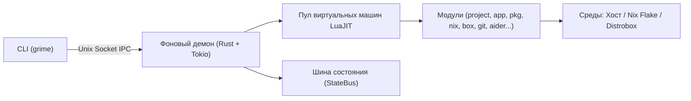

**[ Русский ](README.md) | [ English ](README.en.md)**

# GRIME (Grime-RS)

[](https://github.com/GrimeVoid/grime-rust/releases/tag/v1.1.0)
[](https://www.rust-lang.org/)
[](https://luajit.org/)
[](https://nixos.org/)
[](https://distrobox.it/)
[]()
[](LICENSE)

**GRIME** — это быстрый консольный оркестратор для разработчика на Linux. Он связывает управление проектами, изолированные окружения Nix Flakes, контейнеры Distrobox, системные пакетные менеджеры и AI-ассистента Aider в единый предсказуемый инструмент командной строки.

Главная цель GRIME — избавить основную систему от беспорядка. Вместо того чтобы ставить десятки компиляторов, библиотек и разовых утилит прямо на хост, вы запускаете и собираете код в изолированных воспроизводимых средах одной короткой командой.

---

## Зачем нужен GRIME и какую проблему он решает

При активной разработке на нескольких языках (C++, Rust, Python, Java, Lua) рабочая система быстро обрастает конфликтующими зависимостями, разными версиями компиляторов и забытыми пакетами. Для решения этой проблемы обычно используют Nix, контейнеры Podman/Distrobox и разные сборочные скрипты, но у каждого из них свой синтаксис и свои особенности.

GRIME убирает эту рутину:
- **Чистая хост-система.** Если программа или компилятор нужны на один раз, GRIME прозрачно запустит их через Nixpkgs или внутри контейнера Distrobox, не оставляя следов в системе.
- **Автоматический подбор тулчейна.** Достаточно открыть папку с кодом и вызвать сборку — сканер сам определит языки проекта, сгенерирует окружение Nix Flake в кэше (`~/.cache/grime/`) и соберёт проект без засорения репозитория лишними файлами.
- **Единый язык команд.** Вам не нужно помнить десятки флагов `cmake`, `cargo`, `javac`, `nix` или `distrobox`. Все операции с проектами, сервисами, пакетами и Git подчиняются одной логике.
- **Настоящие конвейеры данных.** Разные модули можно выстраивать в цепочки в одну строку: найти путь к проекту, переключиться в контейнер Fedora, собрать бинарник, вернуться на хост и запустить его.

---

## Философия и принцип работы

Архитектура GRIME строго разделена на два уровня: **нативное микроядро на Rust** и **декларативные модули на LuaJIT**.



1. **Микроядро на Rust (`grime`)**
   Ядро намеренно не содержит привязанной к конкретным утилитам бизнес-логики. Его задача — максимально быстро разобрать командную строку, передать аргументы нужным модулям, выстроить конвейер шагов, обеспечить потокобезопасный обмен данными через шину состояния (`StateBus`) и централизованно обработать ошибки. При остановке любого шага ядро выводит сообщение об ошибке ровно один раз и аккуратно прерывает конвейер.
2. **Фоновый демон и пул LuaJIT VM**
   Демон удерживает в оперативной памяти прогретый пул виртуальных машин LuaJIT и текущее состояние шины (потребляя всего 4–6 МБ RAM). Когда вы вводите команду `grime`, лёгкий клиент связывается с демоном через Unix-сокет за доли миллисекунды. Если демон не запущен, любая команда прозрачно выполнится напрямую в текущем процессе.
3. **Прикладные модули (`modules/*.lua`)**
   Вся логика работы с компиляторами, пакетами, Git, контейнерами и AI живёт в модулях на LuaJIT. Модули редактируются на лету без перекомпиляции ядра, используют общую библиотеку парсинга аргументов (`languages/argparse.lua`) и безопасный нативный API ядра (`grime.ctx`, `grime.fs`, `grime.process`, `grime.bus`, `grime.fuzzy`).

---

## Единый стандарт команд, флагов и конвейеров

Чтобы интерфейс оставался интуитивным во всех модулях, в GRIME действует единый стандарт синтаксиса:

- **Все флаги и действия начинаются со знака минус (`-` или `--`).**
  Например: `-list` (`-ls`), `-path` (`-p`), `-new` (`-n`), `-build` (`-b`), `-run` (`-r`), `-rm`, `-update` (`-u`), `-help` (`-h`). Короткие и полные формы взаимозаменяемы.
- **Свободный порядок сущности и флага.**
  Вы можете писать как `grime project -path grime_pj`, так и `grime project grime_pj -path` — оба варианта сработают одинаково и найдут проект даже по неполному имени (fuzzy-поиск).
- **Разделитель аргументов `//` (или `--`).**
  Если нужно передать внешней программе её собственные флаги, чтобы ядро GRIME их не перехватывало, поставьте перед ними `//`:
  ```bash
  grime cmd // echo -n "проверка"
  grime pkg -run // ffmpeg -i input.mp4 output.webm
  ```
- **Конвейеры модулей через двоеточие `:`.**
  Шаги в одной команде соединяются знаком `:` (в оболочке Fish символ `->` является перенаправлением в файл, поэтому `:` — основной и безопасный разделитель). Каждый шаг автоматически передаёт следующему рабочую директорию (`target_dir`), возвращаемый результат (`pipeline_input`) и данные через `StateBus`:
  ```bash
  grime project -path MyService : git -status : bus -set build.ready true
  ```
- **Переключение сред (`box` / `nix` и возврат через `host`).**
  Модуль `host` служит рубежом, который возвращает выполнение из контейнера Distrobox или окружения Nix обратно на основную ОС:
  ```bash
  grime project -path MyEngine : box fedora-box : project -build : host : project -run
  ```

---

## Основные модули и примеры использования

### 1. Оркестратор проектов (`project`)
Управление проектами разработки на C++, Rust, Python, Java и Lua. Поддерживает нечёткий поиск папок, автоопределение системы сборки и проверку времени изменения исходников (`mtime`) перед запуском.

```bash
# Создать новый проект на выбранном языке
grime project -init rust fast_proxy
grime project -init cpp render_core

# Найти путь к проекту (удобно для быстрого перехода в директорию)
cd (grime project -path grime_pj)

# Собрать и запустить проект (пересборка запустится только если код изменился)
grime project -build grime_pj
grime project -run grime_pj

# Показать список всех проектов
grime project -list
```

### 2. Локальные микроприложения (`app`)
Создание и запуск собственных утилит и сервисов, каждый из которых живёт в своей директории с манифестом `app.lua` и собственным окружением `flake.nix`.

При создании приложения (`-new`) вы можете просто описать задачу человеческим языком: GRIME сам распознает нужный стек (`python`, `java`, `rust`, `lua`, `cpp`) прямо из текста промпта, развернёт шаблон и поручит Aider написать рабочий код.

```bash
# Создать приложение с автовыбором стека из текста описания
grime app -new WeatherCli "консольное приложение на Python для вывода погоды"
grime app -new LogParser "утилита на Rust для фильтрации логов"
grime app -new StoreApi "сервис учёта заказов на Java"

# Получить путь к папке приложения или к корневому каталогу всех аппов
grime app -path WeatherCli
cd (grime app -path)

# Собрать и запустить приложение (в том числе в фоновом режиме демона)
grime app -build WeatherCli
grime app -run WeatherCli
grime app -run LogParser -detach

# Посмотреть активные фоновые сервисы и остановить нужный
grime app -ps
grime app -stop LogParser

# Упаковать приложение со всеми библиотеками в автономный бинарник в папке dist/
grime app -bundle WeatherCli

# Сделать снимок состояния в Git, посмотреть двойной дифф (Git + Nix) или откатить изменения
grime app -snapshot WeatherCli "рабочая версия"
grime app -diff WeatherCli
grime app -rollback WeatherCli
```

### 3. Единый менеджер пакетов и утилит (`pkg`)
Объединяет работу с пакетными менеджерами хоста (`pacman`, `yay`, `dnf`, `apt`), `flatpak`, профилем `nix`, `cargo`, `pipx` и контейнерами `distrobox`.

```bash
# Сводная таблица по всем активным пакетным менеджерам системы
grime pkg

# Посмотреть установленные пакеты конкретного менеджера
grime pkg -pacman
grime pkg -yay
grime pkg -flatpak
grime pkg -nix

# Сквозной нечёткий поиск установленного пакета сразу везде
grime pkg ripgrep

# Установка и удаление пакетов
grime pkg -yay -install neovim
grime pkg -nix -install jq
grime pkg -flatpak -remove org.gimp.GIMP

# Обновление конкретного менеджера или всей системы целиком (yay/pacman + flatpak + nix + distrobox)
grime pkg -update -yay
grime pkg -update

# Разовый запуск любой программы без установки на хост (каскад: локально -> Distrobox -> эфемерный Nix)
grime pkg -run cmatrix
grime pkg -run -y // ffmpeg -version
```

### 4. AI-ассистент разработки (`aider`)
Интеграция AI-агента Aider в рабочий процесс GRIME. Модуль знает структуру ваших проектов и приложений, умеет принимать вывод предыдущих шагов конвейера, анализировать ошибки последнего запуска в терминале и генерировать новые модули GRIME строго по архитектурному стандарту.

```bash
# Запустить Aider в директории проекта по его имени
grime aider grime_pj "оптимизируй парсинг аргументов"

# Передать контекст из конвейера в Aider
grime project -path grime_pj : git -diff : aider -m "проверь изменения и напиши сообщение для коммита"

# Создать новое приложение с нуля через Aider (с автоопределением языка из промпта)
grime aider -app JsonTool "сделай утилиту на Python для форматирования JSON"

# Создать или доработать модуль самого GRIME по стандарту (с автопроверкой luajit -bl и синхронизацией)
grime aider -module netstat "модуль для просмотра открытых портов"
```

### 5. Изолированные окружения Nix (`nix`) и контейнеры (`box`)
```bash
# Выполнить команду в эфемерном окружении Nix DevShell для текущего проекта
grime project -path grime_pj : nix -exec // cargo test

# Управление профилем и хранилищем Nix
grime nix -history
grime nix -gc
grime nix -optimise

# Список контейнеров Distrobox и запуск команд внутри контейнера
grime box -list
grime box fedora-box -run dnf search clang
grime box -export bin /usr/bin/htop
```

### 6. Инфраструктура: Реестр (`list`), Git (`git`), Шина (`bus`), Диагностика (`doctor`)
```bash
# Обзор всей экосистемы (модули, приложения, проекты)
grime list
grime list -modules
grime list -apps
grime list -projects

# Работа с Git в конвейере
grime project -path grime_pj : git -status
grime project -path grime_pj : git -snapshot "перед рефакторингом"

# Обмен данными через шину состояния StateBus
grime bus -set deploy.env production
grime bus -get deploy.env
grime bus -list

# Проверка здоровья системы, путей, сокета демона и логов
grime doctor
grime daemon -status
grime log -list -n 20
```

---

## Скорость работы

Реальные замеры на рабочей системе (среднее, минимальное и максимальное время по серии из 15 прогонов с активным демоном `grimed`):

| Операция / Команда | Среднее (mean) | Минимум (min) | Максимум (max) |
| :--- | :---: | :---: | :---: |
| **Холодный старт ядра (`grime -v`)** | **2.06 мс** | 1.79 мс | 2.58 мс |
| **Вывод справки ядра (`grime -h`)** | **2.75 мс** | 2.01 мс | 6.01 мс |
| **Чтение из шины (`grime bus -get`)** | **3.54 мс** | 3.29 мс | 4.02 мс |
| **Список приложений (`grime list -apps`)** | **4.74 мс** | 4.45 мс | 5.22 мс |
| **Чтение системного лога (`grime log -list -n 5`)** | **4.97 мс** | 4.65 мс | 5.43 мс |
| **Выполнение внешней команды (`grime cmd // echo ok`)** | **5.39 мс** | 4.91 мс | 6.57 мс |
| **Запись в шину с сохранением (`grime bus -set`)** | **5.67 мс** | 5.22 мс | 7.46 мс |
| **Реестр проектов (`grime list -projects`)** | **5.97 мс** | 5.35 мс | 7.00 мс |
| **Нечёткий поиск пути проекта (`grime project -path`)** | **6.62 мс** | 5.84 мс | 10.17 мс |
| **Модуль окружений Nix (`grime nix -h`)** | **6.65 мс** | 6.01 мс | 8.43 мс |
| **Модуль рубежа хоста (`grime host`)** | **6.96 мс** | 4.13 мс | 15.07 мс |
| **Модуль AI-ассистента (`grime aider -h`)** | **7.16 мс** | 6.54 мс | 7.99 мс |
| **Список всех проектов (`grime project -list`)** | **8.84 мс** | 5.59 мс | 13.23 мс |
| **Реестр модулей (`grime list -modules`)** | **9.76 мс** | 8.89 мс | 10.92 мс |
| **Путь к каталогу приложений (`grime app -path`)** | **10.27 мс** | 9.47 мс | 11.46 мс |
| **Полный реестр системы (`grime list`)** | **11.66 мс** | 11.01 мс | 12.97 мс |
| **Диагностика системы (`grime doctor`)** | **21.93 мс** | 21.05 мс | 23.06 мс |
| **Конвейер из 2 шагов (`host : cmd pwd`)** | **6.31 мс** | 5.71 мс | 7.42 мс |
| **Конвейер из 3 шагов (`bus -set : bus -get : bus -rm`)** | **7.49 мс** | 6.91 мс | 8.51 мс |
| **Конвейер из 4 шагов (`project -path : git -branch : bus -set : bus -rm`)** | **16.07 мс** | 15.12 мс | 17.76 мс |

---

## Сборка и установка

### Сборка через Nix Flake (рекомендуется)
```bash
nix build .#static
# или вход в окружение разработки:
nix develop
```

### Сборка через Cargo
```bash
cargo build --release
cp target/release/grime ~/.local/bin/
```

После копирования бинарника в `~/.local/bin/` перезапустите фоновый демон и проверьте окружение:
```bash
grime daemon -restart
grime doctor
```

Для автоматического перехвата неизвестных команд в оболочке Fish добавьте в `~/.config/fish/functions/fish_command_not_found.fish`:
```fish
function fish_command_not_found
    grime pkg -not-found $argv
end
```

---

## Лицензия

Проект распространяется на условиях лицензии **[MIT License](LICENSE)**.  
Copyright (c) 2026 **GrimeVoid / Danny**.
